# Entity Framework Core amb Rider — Guia pas a pas

Aquesta guia explica com crear **des de zero** un projecte d'Entity Framework Core amb **JetBrains Rider**.

- Farem servir **.NET 10** i **EF Core 10**.
- La base de dades pot ser:
  - **Opció A: SQLite** → no cal instal·lar res. **És la que farem servir a l'aula.**
  - **Opció B: SQL Server LocalDB** → la mateixa que al README de Visual Studio. Només funciona si l'equip té LocalDB instal·lat.

> 🔴 **Mira sempre els requadres vermells de les imatges.** Si un requadre té un número, fes els passos en aquest ordre: 1, 2, 3...

> 💾 **Equips congelats:** desa sempre el projecte a **`D:\`**. El que guardis a `C:\` s'esborra quan reinicies l'ordinador.
> (A algunes captures surt `F:\` perquè s'han fet en un altre ordinador. Tu has de fer servir `D:\`.)

---

## Índex

0. [Abans de començar](#0-abans-de-començar)
1. [Crear el projecte](#1-crear-el-projecte)
2. [Instal·lar els paquets NuGet](#2-installar-els-paquets-nuget)
3. [Desactivar els «nullable»](#3-desactivar-els-nullable)
4. [Crear les classes del model](#4-crear-les-classes-del-model)
5. [Crear el DbContext](#5-crear-el-dbcontext)
6. [Escriure el Program.cs](#6-escriure-el-programcs)
7. [Executar el programa](#7-executar-el-programa)
8. [Veure la base de dades SQLite a Rider](#8-veure-la-base-de-dades-sqlite-a-rider)
9. [Opció B: SQL Server LocalDB](#9-opció-b-sql-server-localdb)
10. [Problemes freqüents](#10-problemes-freqüents)

---

## 0. Abans de començar

Comprova que l'equip té **.NET 10**. Obre un terminal (a Rider: menú **View › Tool Windows › Terminal**) i escriu:

```
dotnet --list-sdks
```

Ha de sortir una línia que comenci per **`10.`**, per exemple:

```
10.0.404 [C:\Program Files\dotnet\sdk]
```

Si no surt cap línia amb `10.`, avisa el professor.

---

## 1. Crear el projecte

### 1.1 Obre el menú «New Solution»

Fes clic a les **tres ratlles** de dalt a l'esquerra (1). Després ves a **File › New Solution...** (2).

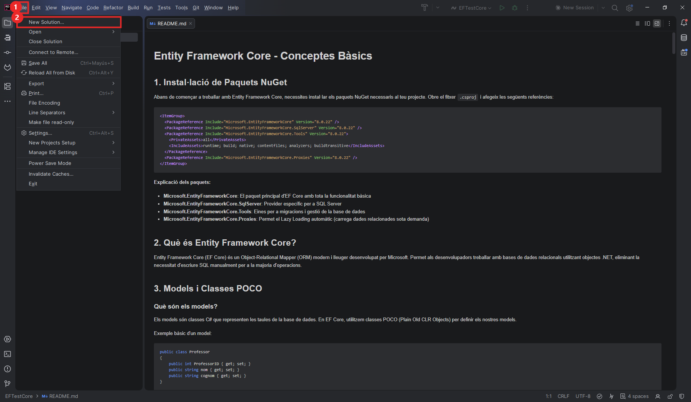

### 1.2 Omple la finestra

| Núm. | Què has de fer |
|---|---|
| 1 | Tria **Console** |
| 2 | **Solution name**: `EscolaEF` |
| 3 | **Solution directory**: `D:\` |
| 4 | **Target framework**: `net10.0` ⚠️ **No** triïs `net11.0` |
| 5 | Fes clic a **Create** |

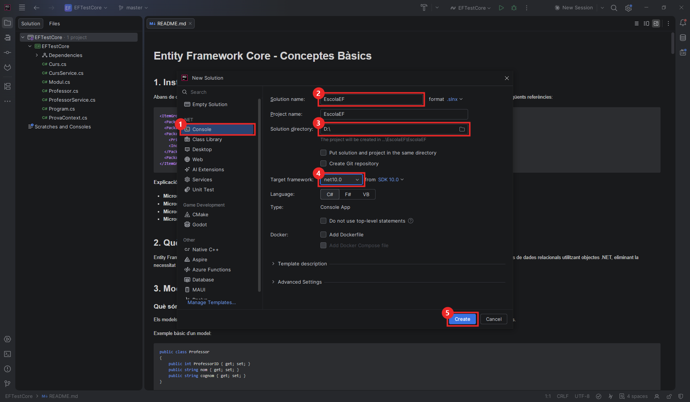

Si et pregunta *«This Window / New Window»*, tria **This Window**.

### 1.3 Projecte creat

A l'esquerra ha d'aparèixer el projecte **EscolaEF** amb un fitxer **Program.cs**.

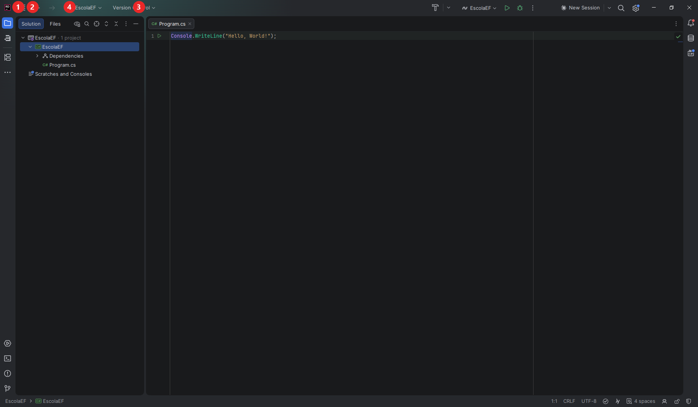

---

## 2. Instal·lar els paquets NuGet

Necessitem **5 paquets**, tots a la **mateixa versió: `10.0.15`**.

| Paquet | Per a què serveix |
|---|---|
| `Microsoft.EntityFrameworkCore` | El paquet principal d'EF Core |
| `Microsoft.EntityFrameworkCore.Sqlite` | Per connectar amb **SQLite** (opció A) |
| `Microsoft.EntityFrameworkCore.SqlServer` | Per connectar amb **SQL Server / LocalDB** (opció B) |
| `Microsoft.EntityFrameworkCore.Tools` | Eines per a migracions |
| `Microsoft.EntityFrameworkCore.Proxies` | Per al **Lazy Loading** (`virtual`) |

> Al README de Visual Studio la versió és `8.0.22`. Aquí fem servir **`10.0.15`** perquè el projecte és **.NET 10**.

### 2.1 Obre el gestor de NuGet

Fes **clic dret** sobre el projecte **EscolaEF** (el de la icona verda) › **Manage NuGet Packages**.

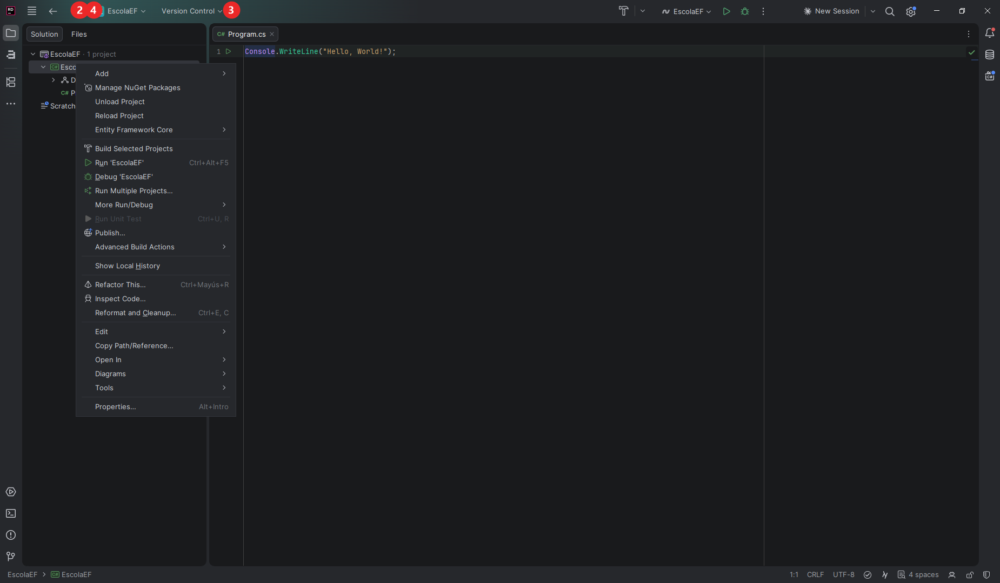

### 2.2 Cerca el paquet

| Núm. | Què has de fer |
|---|---|
| 1 | Pestanya **Discover** |
| 2 | Escriu `Microsoft.EntityFrameworkCore` |
| 3 | **Treu la marca** de **Prerelease** |
| 4 | Fes clic al paquet **Microsoft.EntityFrameworkCore** |

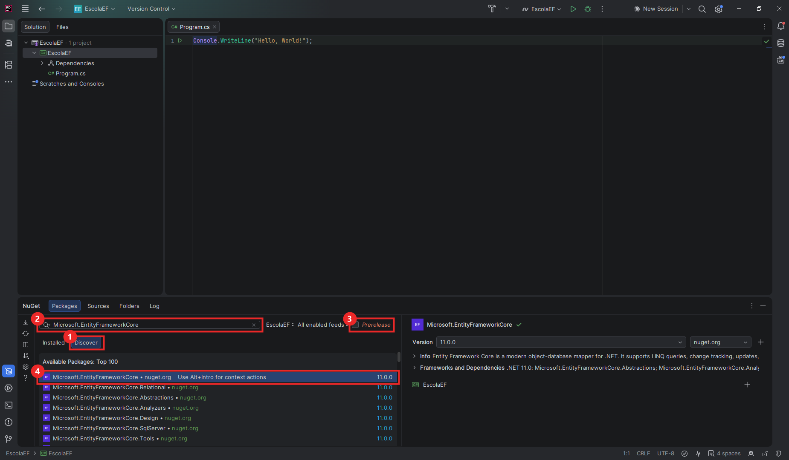

### 2.3 Tria la versió 10.0.15 ⚠️ MOLT IMPORTANT

Per defecte surt la versió **11.0.0**, i aquesta **NO funciona amb .NET 10**.

1. Obre el desplegable **Version**.
2. Tria **10.0.15**.

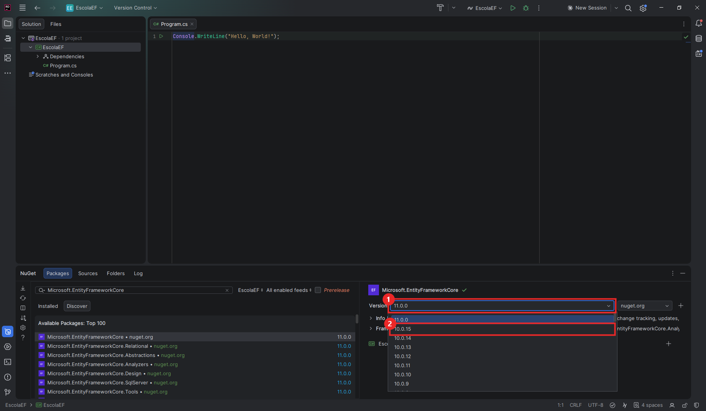

### 2.4 Instal·la

Comprova que la versió és **10.0.15** (1) i fes clic al **+** del costat d'**EscolaEF** (2).

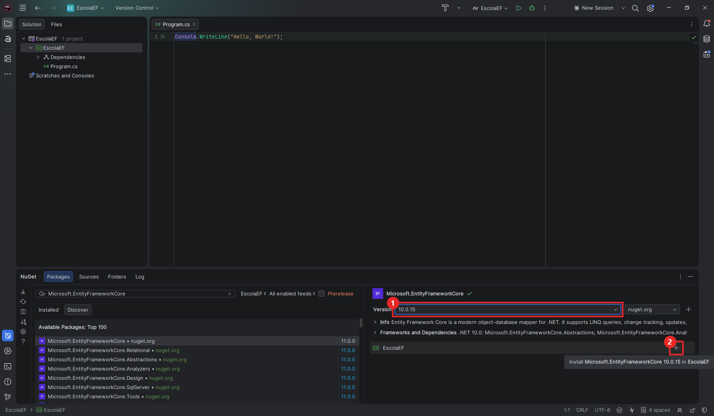

Sortirà un missatge com aquest: *«... was successfully installed to EscolaEF»*.

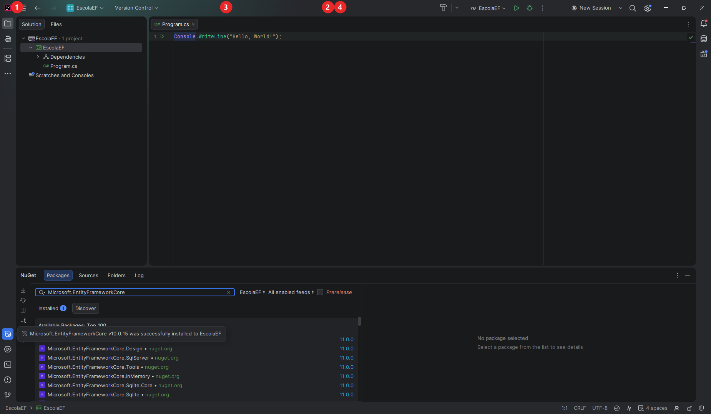

### 2.5 Repeteix-ho amb els altres 4 paquets

Fes el mateix (passos 2.2, 2.3 i 2.4) per a:

- `Microsoft.EntityFrameworkCore.Sqlite`
- `Microsoft.EntityFrameworkCore.SqlServer`
- `Microsoft.EntityFrameworkCore.Tools`
- `Microsoft.EntityFrameworkCore.Proxies`

Recorda: **sempre la versió 10.0.15**.

### 2.6 Comprova-ho

A la pestanya **Installed** (1) han de sortir els **5 paquets**, tots amb **10.0.15** (2).

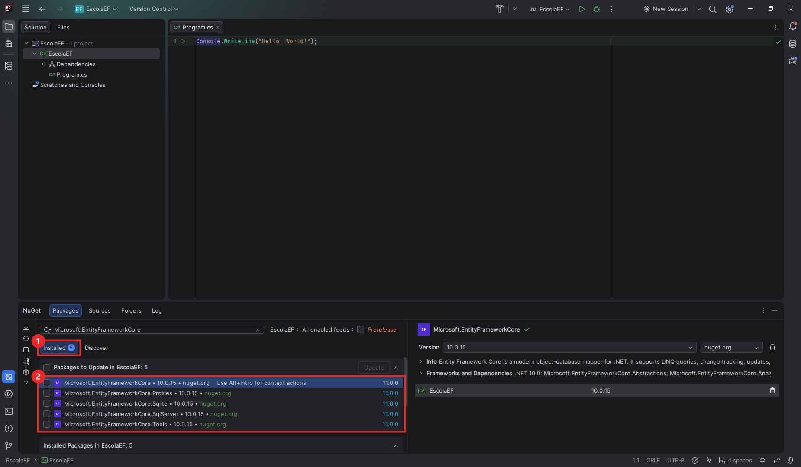

> ⛔ Rider et dirà que hi ha *«Packages to Update»* (versió 11.0.0). **NO facis clic a Update.** Si ho fas, el projecte deixarà de compilar.

<details markdown="1">
<summary>🛠️ Alternativa ràpida per terminal (opcional)</summary>

Des del terminal de Rider, dins la carpeta del projecte (`D:\EscolaEF\EscolaEF`):

```
dotnet add package Microsoft.EntityFrameworkCore --version 10.0.15
dotnet add package Microsoft.EntityFrameworkCore.Sqlite --version 10.0.15
dotnet add package Microsoft.EntityFrameworkCore.SqlServer --version 10.0.15
dotnet add package Microsoft.EntityFrameworkCore.Tools --version 10.0.15
dotnet add package Microsoft.EntityFrameworkCore.Proxies --version 10.0.15
```
</details>

---

## 3. Desactivar els «nullable»

Els projectes nous de .NET tenen activats els *nullable reference types*. Això canvia una cosa important respecte a la teoria:

- Amb `nullable` **activat**: un `string` es crea com a `NOT NULL` a la base de dades.
- Amb `nullable` **desactivat**: un `string` és `NULL`, tal com diu el README de teoria.

Per fer-ho igual que a la teoria, el desactivem:

1. Fes **doble clic** sobre el projecte **EscolaEF** (la icona verda). S'obrirà el fitxer `EscolaEF.csproj`.
2. Canvia `enable` per **`disable`** a la línia de `Nullable`:

```xml
<Nullable>disable</Nullable>
```

El fitxer `EscolaEF.csproj` ha de quedar així:

```xml
<Project Sdk="Microsoft.NET.Sdk">

    <PropertyGroup>
        <OutputType>Exe</OutputType>
        <TargetFramework>net10.0</TargetFramework>
        <ImplicitUsings>enable</ImplicitUsings>
        <Nullable>disable</Nullable>
    </PropertyGroup>

    <ItemGroup>
      <PackageReference Include="Microsoft.EntityFrameworkCore" Version="10.0.15" />
      <PackageReference Include="Microsoft.EntityFrameworkCore.Proxies" Version="10.0.15" />
      <PackageReference Include="Microsoft.EntityFrameworkCore.Sqlite" Version="10.0.15" />
      <PackageReference Include="Microsoft.EntityFrameworkCore.SqlServer" Version="10.0.15" />
      <PackageReference Include="Microsoft.EntityFrameworkCore.Tools" Version="10.0.15">
        <IncludeAssets>runtime; build; native; contentfiles; analyzers; buildtransitive</IncludeAssets>
        <PrivateAssets>all</PrivateAssets>
      </PackageReference>
    </ItemGroup>

</Project>
```

---

## 4. Crear les classes del model

Crearem 3 classes: **Professor**, **Curs** i **Modul**.

### 4.1 Afegir una classe nova

**Clic dret** sobre **EscolaEF** › **Add** (1) › **Class/Interface** (2).

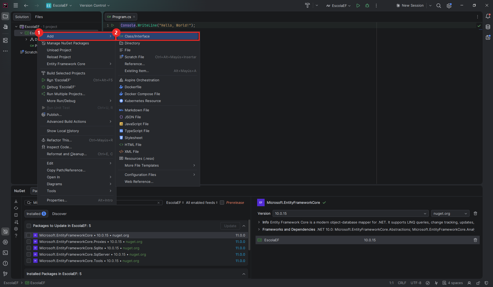

Escriu el nom de la classe (1), per exemple `Professor`, i prem **Enter** (o fes clic a **Class** (2)).

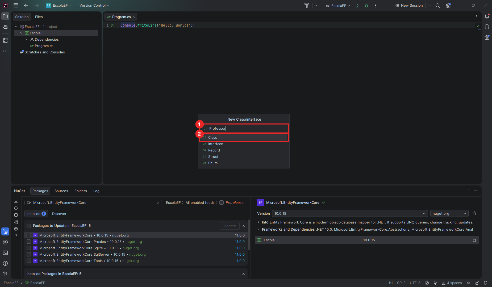

Rider crea el fitxer `Professor.cs` (1) amb una classe buida (2).

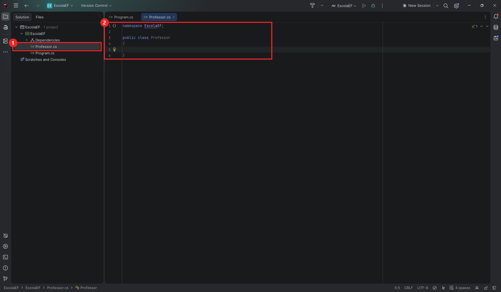

**Fes el mateix per crear `Curs` i `Modul`.**

### 4.2 Professor.cs

Esborra tot el que hi ha al fitxer i **copia aquest codi**:

```csharp
using System.ComponentModel.DataAnnotations;

namespace EscolaEF;

public class Professor
{
    public int ProfessorID { get; set; }

    [Required]
    public string nom { get; set; }
    public string cognom { get; set; }

    // 1-1: un professor és tutor d'un curs
    public virtual Curs Curs { get; set; }

    // N-N: un professor fa molts mòduls
    public virtual ICollection<Modul> Moduls { get; set; }

    public Professor()
    {
        Moduls = new HashSet<Modul>();
    }
}
```

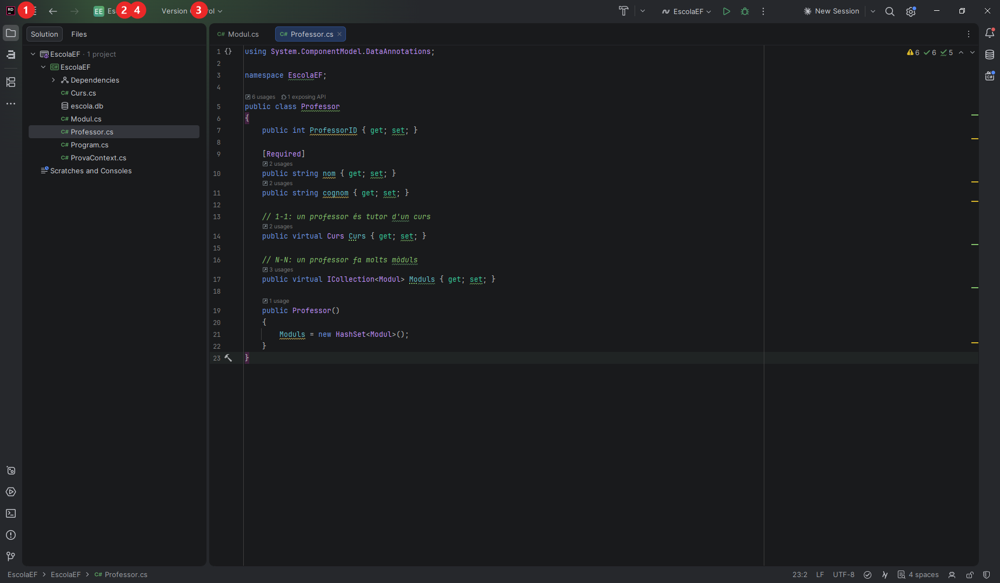

### 4.3 Curs.cs

```csharp
namespace EscolaEF;

public enum CicleFormatiu { DAMVI, DAW, ASIX, SMX }

public class Curs
{
    public int CursID { get; set; }
    public CicleFormatiu Cicle { get; set; }
    public bool Actiu { get; set; }
    public int Any { get; set; }

    // 1-1: el curs té un professor tutor (la FK és aquí)
    public int? ProfessorID { get; set; }
    public virtual Professor Professor { get; set; }

    // 1-N: un curs té molts mòduls
    public virtual ICollection<Modul> Moduls { get; set; }

    public Curs()
    {
        Moduls = new HashSet<Modul>();
    }
}
```

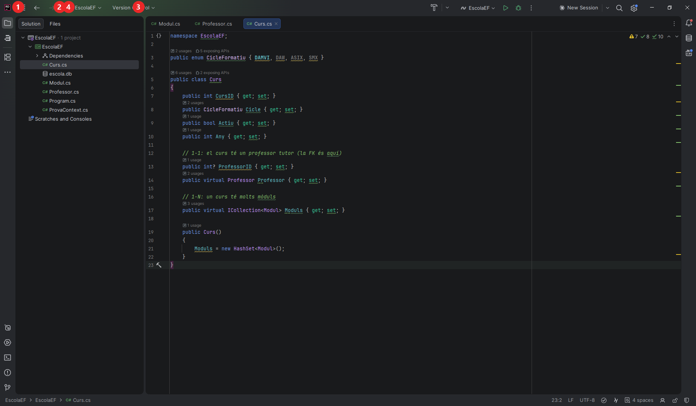

### 4.4 Modul.cs

```csharp
using System.ComponentModel.DataAnnotations;
using System.ComponentModel.DataAnnotations.Schema;

namespace EscolaEF;

[Table("Modul")]
public class Modul
{
    [Key]
    [DatabaseGenerated(DatabaseGeneratedOption.None)]
    public int Codi { get; set; }

    [Required]
    public string nom { get; set; }
    public int horesSetmana { get; set; }

    // 1-N: el mòdul pertany a un curs
    public virtual Curs Curs { get; set; }

    // N-N: un mòdul el fan molts professors
    public virtual ICollection<Professor> Professors { get; set; }

    // N-N recursiva
    public virtual ICollection<Modul> Prerequisits { get; set; }
    public virtual ICollection<Modul> EsPrerequisitDe { get; set; }

    public Modul()
    {
        Professors = new HashSet<Professor>();
        Prerequisits = new HashSet<Modul>();
        EsPrerequisitDe = new HashSet<Modul>();
    }
}
```

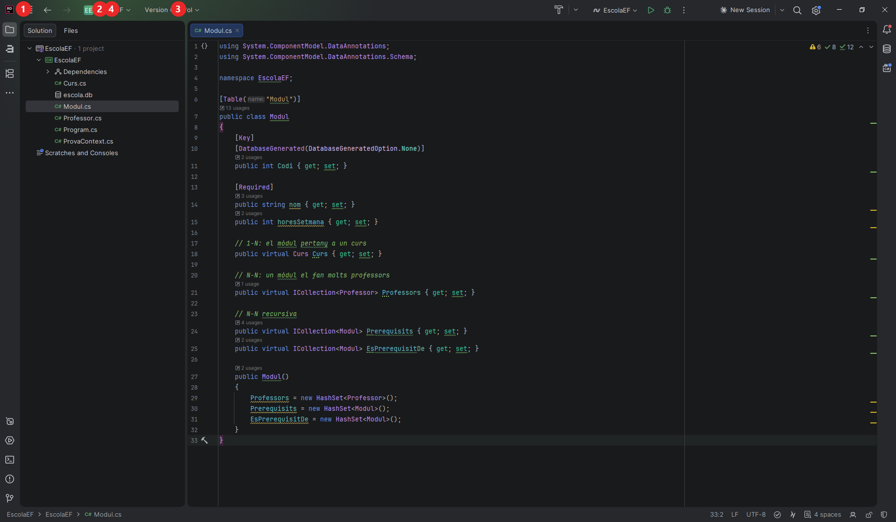

---

## 5. Crear el DbContext

Crea una classe nova que es digui **`ProvaContext`** (com al pas 4.1) i copia aquest codi:

```csharp
using Microsoft.EntityFrameworkCore;

namespace EscolaEF;

public class ProvaContext : DbContext
{
    public DbSet<Professor> Professor { get; set; }
    public DbSet<Modul> Modul { get; set; }
    public DbSet<Curs> Curs { get; set; }

    protected override void OnConfiguring(DbContextOptionsBuilder optionsBuilder)
    {
        if (!optionsBuilder.IsConfigured)
        {
            optionsBuilder
                // OPCIÓ A: SQLite (no cal instal·lar res)
                .UseSqlite(@"Data Source=escola.db")
                // OPCIÓ B: SQL Server LocalDB (comenta la línia de dalt i descomenta aquesta)
                // .UseSqlServer(@"Server=(localdb)\mssqllocaldb;Database=EscolaEF;Trusted_Connection=True;")
                .UseLazyLoadingProxies();
        }
    }

    protected override void OnModelCreating(ModelBuilder modelBuilder)
    {
        // 1-1: Curs <-> Professor (la FK és a Curs)
        modelBuilder.Entity<Curs>()
            .HasOne(c => c.Professor)
            .WithOne(p => p.Curs)
            .HasForeignKey<Curs>(c => c.ProfessorID);

        // N-N recursiva: Modul <-> Prerequisits
        modelBuilder.Entity<Modul>()
            .HasMany(m => m.Prerequisits)
            .WithMany(m => m.EsPrerequisitDe)
            .UsingEntity(j => j.ToTable("Prerequisits"));

        base.OnModelCreating(modelBuilder);
    }
}
```

El requadre (2) marca **la part més important**: la línia que diu **quina base de dades** fem servir.

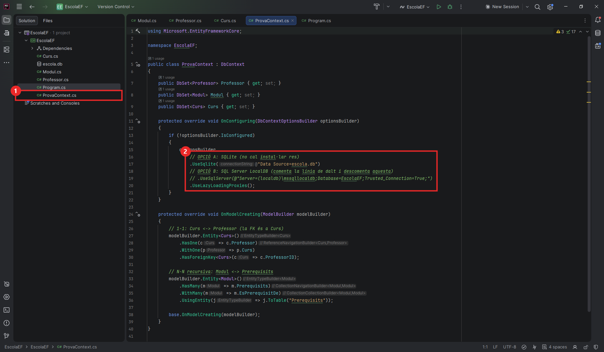

> **Què ha canviat respecte al README de Visual Studio?** Només una línia: `UseSqlite(...)` en lloc de `UseSqlServer(...)`. La resta del codi d'EF és exactament igual.

---

## 6. Escriure el Program.cs

Obre **Program.cs**, esborra el `Console.WriteLine("Hello, World!");` i copia aquest codi:

```csharp
using EscolaEF;

using (var ctx = new ProvaContext())
{
    ctx.Database.EnsureDeleted();
    ctx.Database.EnsureCreated();

    var marc = new Professor { nom = "Marc", cognom = "Albareda" };
    var m6 = new Modul { Codi = 6, nom = "Accés a Dades", horesSetmana = 4 };
    var m3 = new Modul { Codi = 3, nom = "Programació", horesSetmana = 7 };

    var segonDvi = new Curs { Cicle = CicleFormatiu.DAMVI, Actiu = true, Any = 2026, Professor = marc };
    segonDvi.Moduls.Add(m6);
    segonDvi.Moduls.Add(m3);
    marc.Moduls.Add(m6);
    marc.Moduls.Add(m3);
    m6.Prerequisits.Add(m3);

    ctx.Curs.Add(segonDvi);
    ctx.SaveChanges();

    Professor prof = ctx.Professor.First(p => p.cognom == "Albareda");
    Console.WriteLine($"Professor trobat: {prof.nom}");
    Console.WriteLine($"Cicle on ensenya: {prof.Curs.Cicle}");

    foreach (Modul preq in ctx.Modul.Find(6).Prerequisits)
        Console.WriteLine($"Prerequisit de M6: {preq.nom}");
}
```

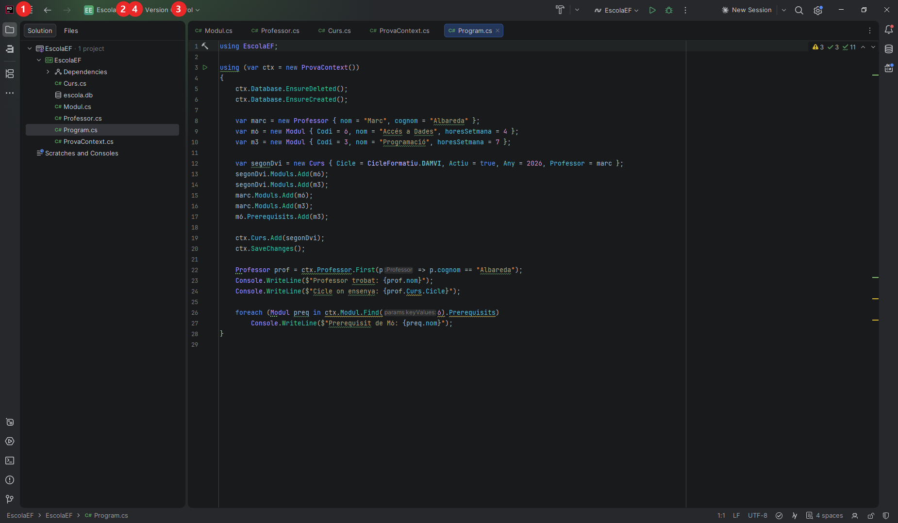

---

## 7. Executar el programa

Fes clic al **triangle verd ▶** de dalt.

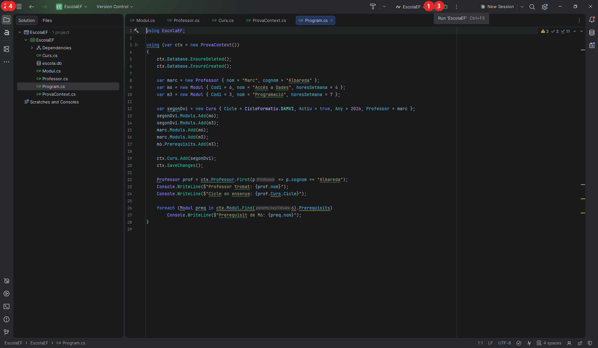

A baix s'obre la finestra **Run**. Si tot va bé, hi ha de sortir:

```
Professor trobat: Marc
Cicle on ensenya: DAMVI
Prerequisit de M6: Programació

Process finished with exit code 0.
```

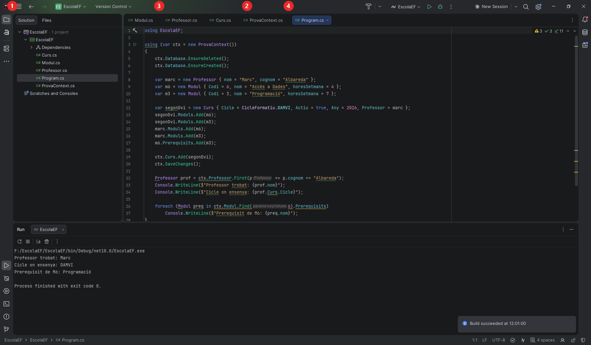

> 📁 El fitxer de la base de dades **`escola.db`** es crea a la carpeta **`D:\EscolaEF\EscolaEF\bin\Debug\net10.0\`**.

---

## 8. Veure la base de dades SQLite a Rider

### 8.1 Obre la finestra Database

| Núm. | Què has de fer |
|---|---|
| 1 | Fes clic a la icona **Database** (el cilindre de la dreta) |
| 2 | Fes clic al **+** |
| 3 | Tria **Data Source from File/Folder** |

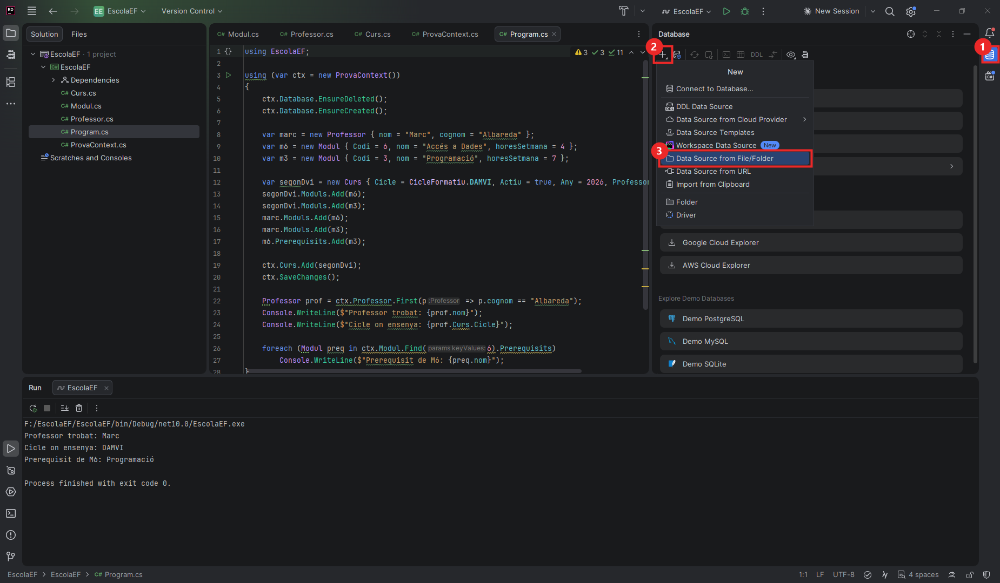

### 8.2 Tria el fitxer escola.db

1. Ves a la carpeta `D:\EscolaEF\EscolaEF\bin\Debug\net10.0` (a la captura surt `F:`).
2. Escriu `escola.db` a **Nombre**.
3. Fes clic al botó per acceptar.

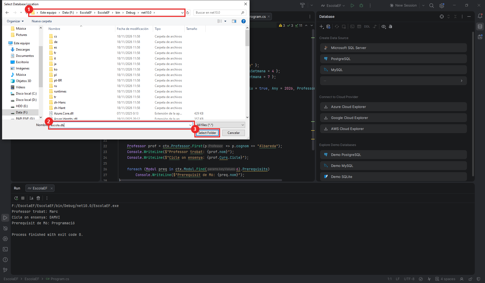

Rider detecta que és **SQLite** (2). Fes clic a **OK** (3).

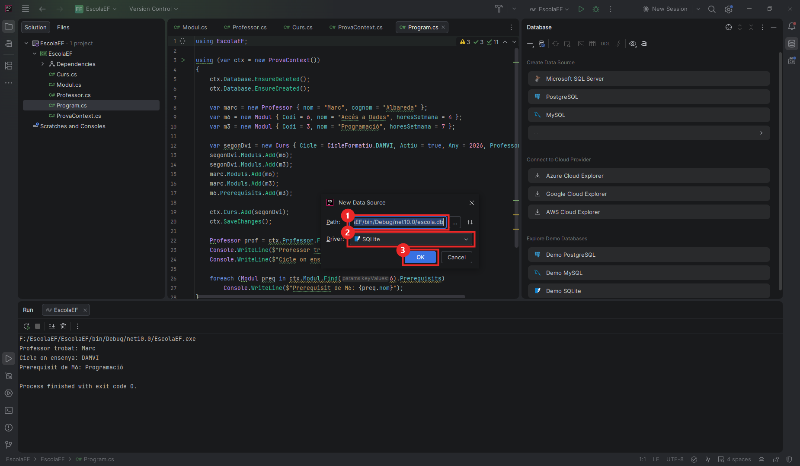

### 8.3 Baixa el driver (només la primera vegada)

Si posa **«SQLite Not downloaded»**, fes clic a **Download**. Si surt una finestra *«Incomplete Configuration»*, fes clic a **Download Driver Files**.

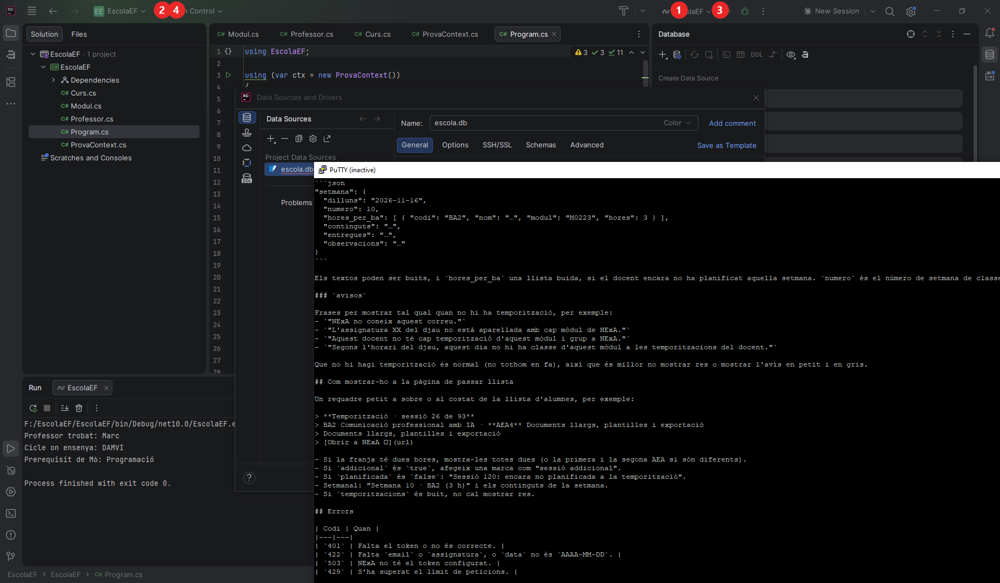

Fes clic a **Test Connection**. Ha de sortir **Succeeded** (1). Després fes clic a **OK** (2).

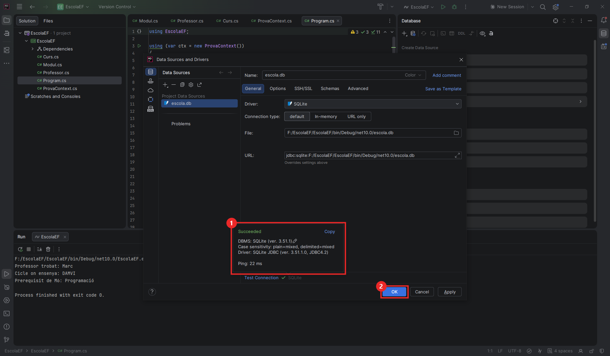

### 8.4 Mira les taules

Obre **escola.db › main › tables**. Hi ha d'haver les taules que ha creat EF:

- `Curs`, `Modul`, `Professor` → una per cada classe
- `ModulProfessor` → la taula intermèdia de la relació **N-N** (EF la crea sola)
- `Prerequisits` → la taula de la relació **recursiva**

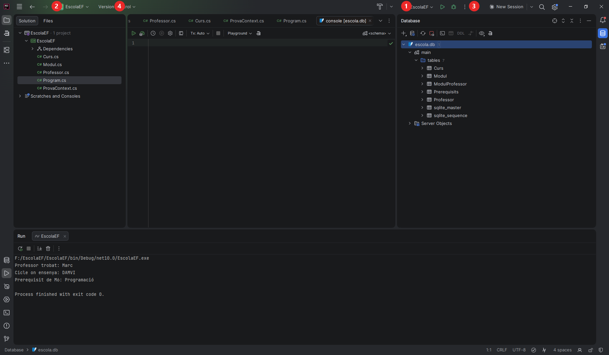

### 8.5 Fes una consulta SQL

S'obre una pestanya **console**. Escriu `SELECT * FROM Modul;` (2) i fes clic al **▶** verd (1). A baix surten les dades (3).

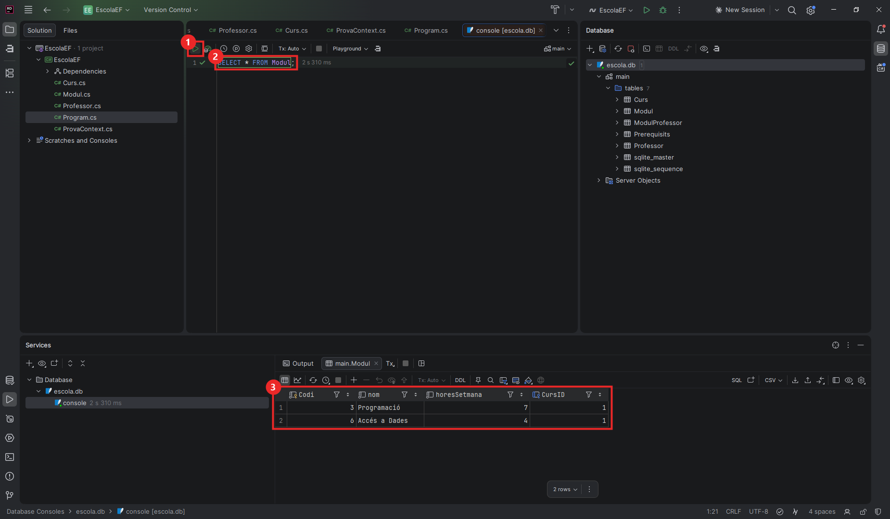

---

## 9. Opció B: SQL Server LocalDB

> ⚠️ Només funciona si l'equip té **SQL Server LocalDB** instal·lat. Per comprovar-ho, escriu `sqllocaldb info` al terminal: ha de sortir `MSSQLLocalDB`. **Als equips congelats de l'aula no hi és**: fes servir l'opció A (SQLite).

### 9.1 Canvia una línia del DbContext

A **ProvaContext.cs**:

- **Comenta** la línia de `UseSqlite` (posa-hi `//` al davant).
- **Descomenta** la línia de `UseSqlServer` (treu-ne el `//`).

```csharp
optionsBuilder
    // OPCIÓ A: SQLite (no cal instal·lar res)
    // .UseSqlite(@"Data Source=escola.db")
    // OPCIÓ B: SQL Server LocalDB
    .UseSqlServer(@"Server=(localdb)\mssqllocaldb;Database=EscolaEF;Trusted_Connection=True;")
    .UseLazyLoadingProxies();
```

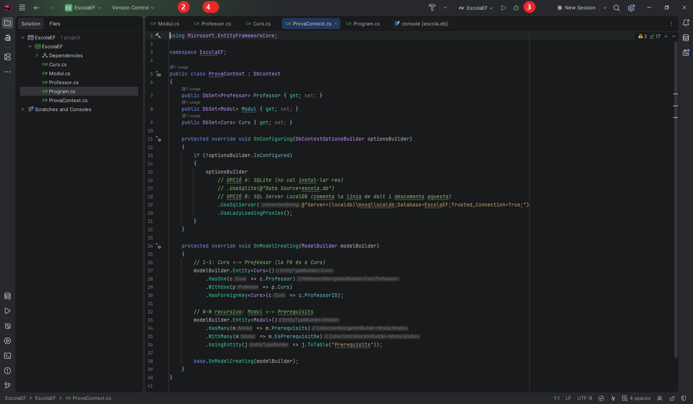

### 9.2 Executa

Fes clic al **▶** verd. Ha de sortir **el mateix resultat** que amb SQLite.

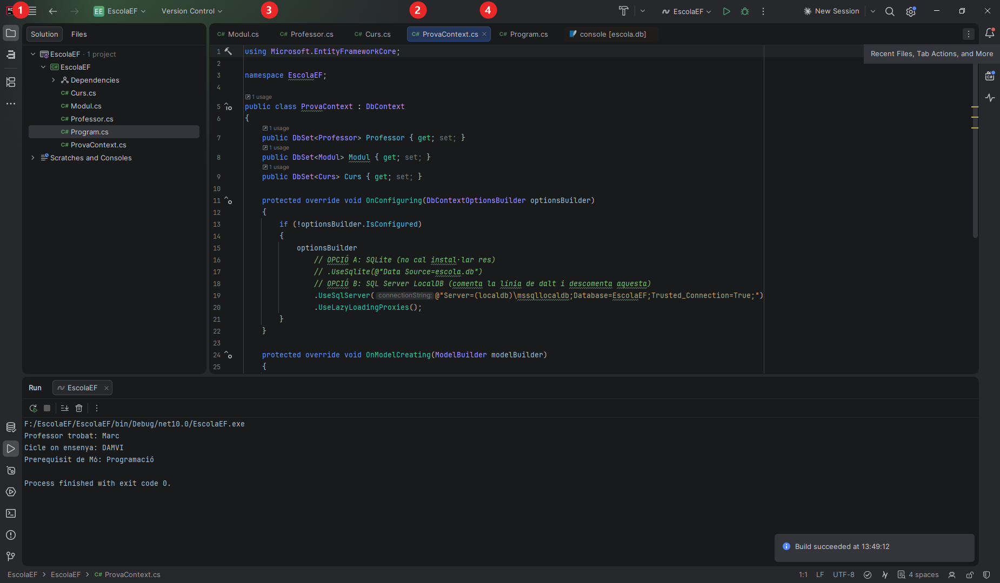

### 9.3 Connecta Rider a LocalDB

A la finestra **Database**, fes clic al **+** (1) › **Connect to Database...** (2).

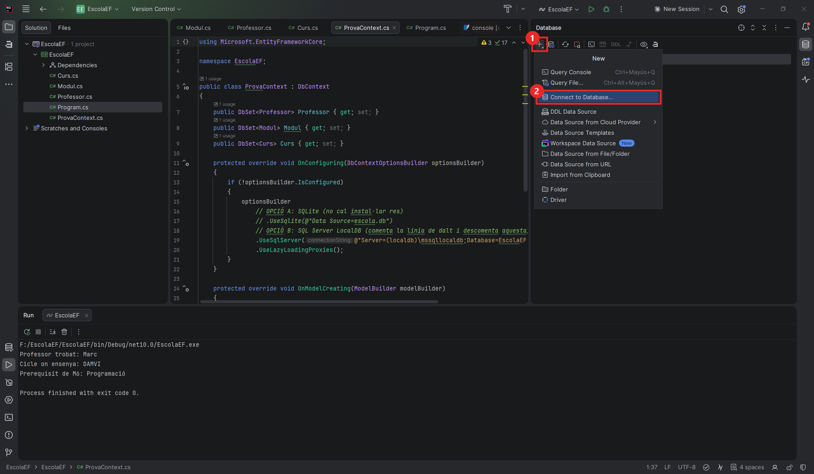

| Núm. | Què has de fer |
|---|---|
| 1 | Tria **Use connection string** |
| 2 | Enganxa la cadena: `Server=(localdb)\mssqllocaldb;Database=EscolaEF;Trusted_Connection=True;` |
| 3 | Fes clic a **Test Connection** |

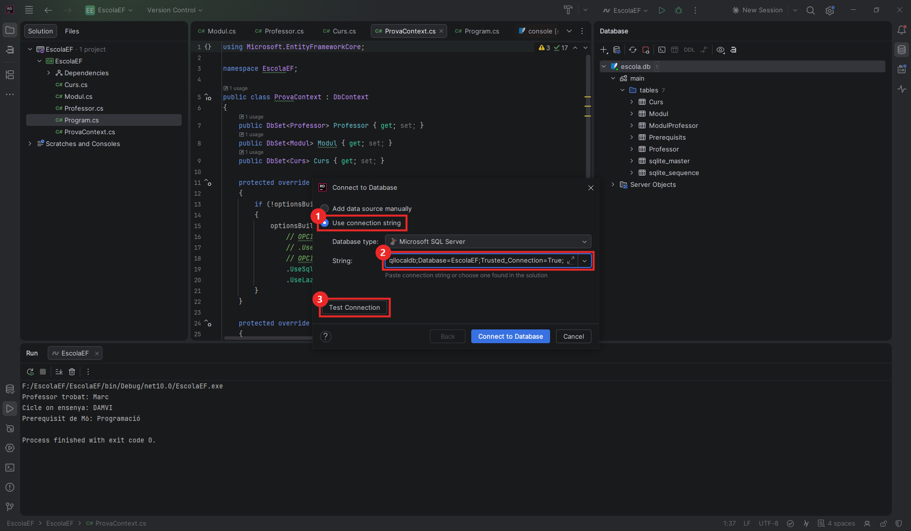

Ha de sortir **Test connection succeeded** (1). Fes clic a **Connect to Database** (2).

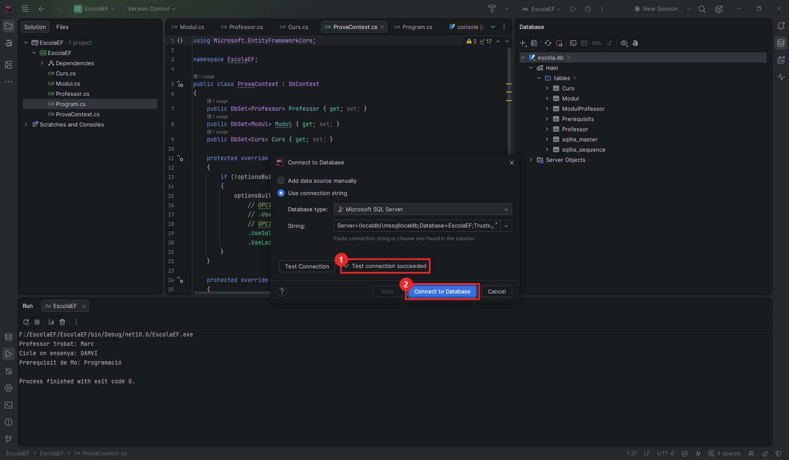

### 9.4 Mira les taules i fes una consulta

Obre **EscolaEF › EscolaEF › dbo › tables** (1). Són les mateixes taules que amb SQLite. A la consola, escriu `SELECT * FROM Professor;` (2) i executa-la. A baix surten les dades (3).

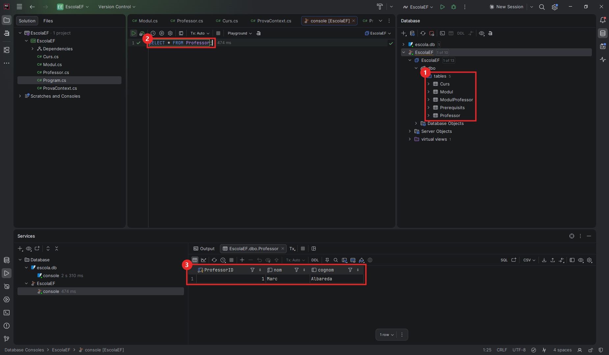

---

## 10. Problemes freqüents

| Problema | Solució |
|---|---|
| Error *«... is not compatible with net10.0»* o *«requires .NET 11»* | Has instal·lat un paquet a la versió **11.0.0**. Torna a NuGet i canvia'l a **10.0.15**. |
| Els paquets no tenen tots la mateixa versió | Posa'ls **tots a 10.0.15**. Barrejar versions dona errors. |
| No surt `net10.0` a «Target framework» | L'equip no té el SDK de .NET 10. Avisa el professor. |
| Error *«A network-related or instance-specific error... (localdb)»* | L'equip no té LocalDB. Fes servir **SQLite** (opció A). |
| Després de reiniciar, el projecte ha desaparegut | L'havies desat a `C:\`. Desa'l sempre a **`D:\`**. |
| La finestra Database no mostra dades noves | Fes clic a la icona de **refrescar** (🔄) de la finestra Database. |
| Error *«The entity type ... requires a primary key»* | La clau primària s'ha de dir `ID` o `NomClasseID`, o ha de tenir `[Key]`. |
| `NullReferenceException` en accedir a `prof.Curs` | Revisa que tens `.UseLazyLoadingProxies()` i que la propietat és **`virtual`**. |
