# Entity Framework Core amb Visual Studio — Guia pas a pas

Aquesta guia explica com crear **des de zero** un projecte d'Entity Framework Core amb **Visual Studio 2022**.

- Farem servir **.NET 8** i **EF Core 8.0.22**, les mateixes versions que el README de teoria.
- La base de dades pot ser:
  - **Opció A: SQLite** → no cal instal·lar res.
  - **Opció B: SQL Server LocalDB** → la del README de teoria. Visual Studio la porta si s'ha instal·lat amb la càrrega de treball de dades.

> 🔴 **Mira sempre els requadres vermells de les imatges.** Si un requadre té un número, fes els passos en aquest ordre: 1, 2, 3...

> 💾 **Equips congelats:** desa sempre el projecte a **`D:\`**. El que guardis a `C:\` s'esborra quan reinicies l'ordinador.

> 🌐 Les captures són de Visual Studio **en castellà**. Si el teu és en català o en anglès, els botons estan al mateix lloc, però amb un altre nom.

---

## Índex

0. [Abans de començar](#0-abans-de-començar)
1. [Crear el projecte](#1-crear-el-projecte)
2. [Instal·lar els paquets NuGet](#2-installar-els-paquets-nuget)
3. [Desactivar els «nullable»](#3-desactivar-els-nullable)
4. [Crear les classes del model](#4-crear-les-classes-del-model)
5. [Crear el DbContext](#5-crear-el-dbcontext)
6. [Escriure el Program.cs](#6-escriure-el-programcs)
7. [Executar el programa](#7-executar-el-programa)
8. [Opció B: SQL Server LocalDB](#8-opció-b-sql-server-localdb)
9. [Problemes freqüents](#9-problemes-freqüents)

---

## 0. Abans de començar

Visual Studio 2022 ha de tenir instal·lades aquestes **càrregues de treball** (*Visual Studio Installer › Modificar*):

- **Desarrollo de escritorio de .NET**
- **Almacenamiento y procesamiento de datos** (porta SQL Server LocalDB, només cal per a l'opció B)

> ⚠️ Visual Studio 2022 **no** pot crear projectes de .NET 10. Per això aquí fem servir **.NET 8**. Si vols .NET 10, fes servir Rider (hi ha una altra guia) o Visual Studio 2026.

---

## 1. Crear el projecte

### 1.1 Crea un projecte nou

Quan obris Visual Studio, fes clic a **Crear un proyecto**.

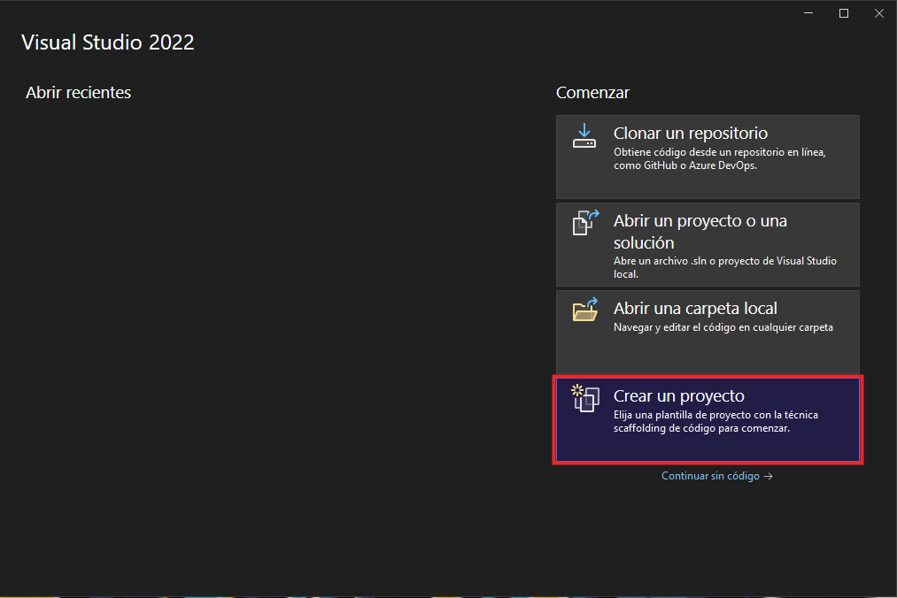

### 1.2 Tria la plantilla

| Núm. | Què has de fer |
|---|---|
| 1 | Escriu `consola` al cercador |
| 2 | Tria **Aplicación de consola** amb l'etiqueta **C#** ⚠️ **No** triïs la que posa *(.NET Framework)* ni la de *Visual Basic* |
| 3 | Fes clic a **Siguiente** |

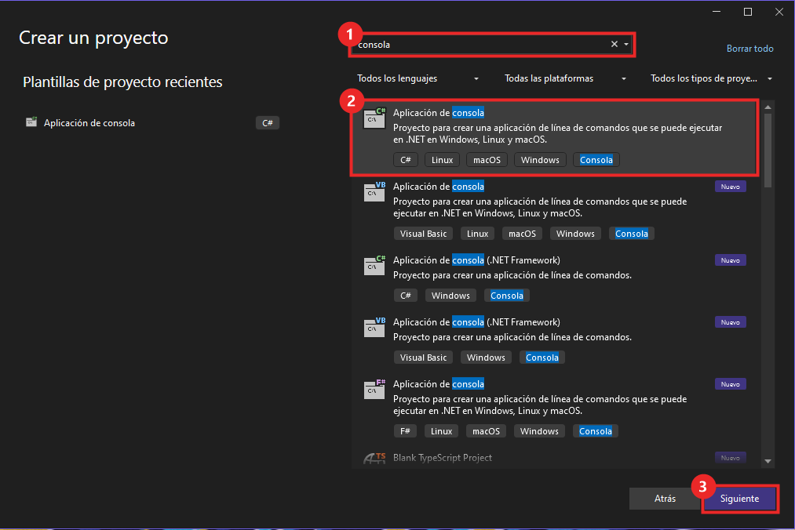

### 1.3 Nom i ubicació

| Núm. | Què has de fer |
|---|---|
| 1 | **Nombre del proyecto**: `EscolaEF` |
| 2 | **Ubicación**: `D:\` |
| 3 | Fes clic a **Siguiente** |

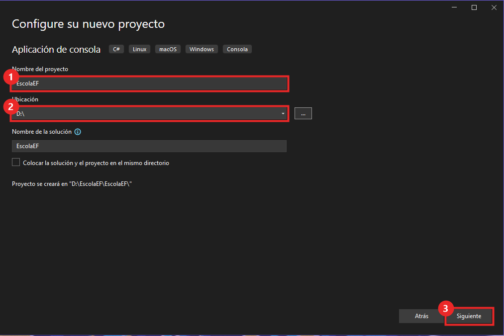

### 1.4 Tria .NET 8

Comprova que el **Framework** és **.NET 8.0 (Compatibilidad a largo plazo)** (1) i fes clic a **Crear** (2).

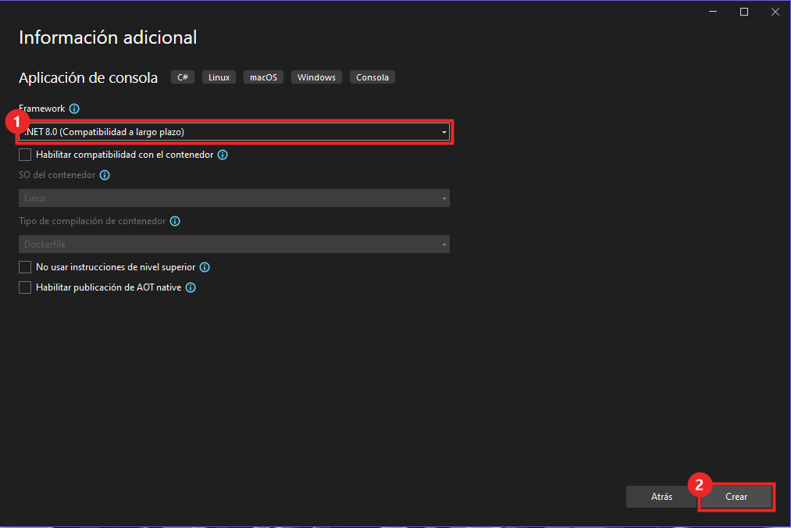

### 1.5 Projecte creat

A la dreta, a l'**Explorador de soluciones**, ha d'aparèixer el projecte **EscolaEF** amb un fitxer **Program.cs**.

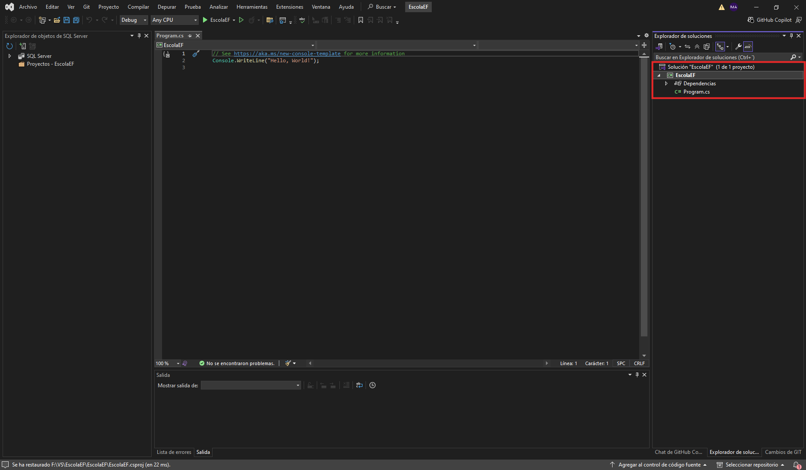

---

## 2. Instal·lar els paquets NuGet

Necessitem **5 paquets**, tots a la **mateixa versió: `8.0.22`**.

| Paquet | Per a què serveix |
|---|---|
| `Microsoft.EntityFrameworkCore` | El paquet principal d'EF Core |
| `Microsoft.EntityFrameworkCore.Sqlite` | Per connectar amb **SQLite** (opció A) |
| `Microsoft.EntityFrameworkCore.SqlServer` | Per connectar amb **SQL Server / LocalDB** (opció B) |
| `Microsoft.EntityFrameworkCore.Tools` | Eines per a migracions |
| `Microsoft.EntityFrameworkCore.Proxies` | Per al **Lazy Loading** (`virtual`) |

### 2.1 Obre el gestor de NuGet

A l'**Explorador de soluciones**, fes **clic dret** sobre el projecte **EscolaEF** › **Administrar paquetes NuGet...**

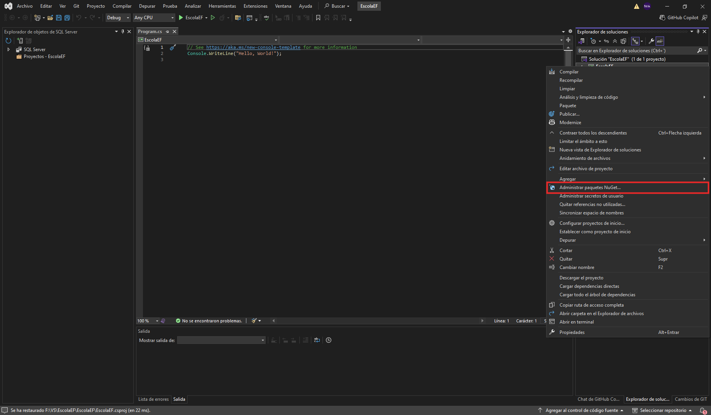

### 2.2 Cerca el paquet

| Núm. | Què has de fer |
|---|---|
| 1 | Pestanya **Examinar** |
| 2 | Escriu `Microsoft.EntityFrameworkCore` |
| 3 | Comprova que **Incluir versión preliminar** està **desmarcat** |
| 4 | Fes clic al paquet **Microsoft.EntityFrameworkCore** |

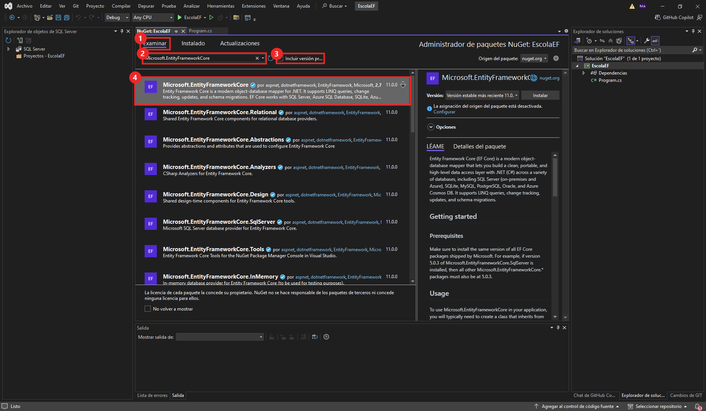

### 2.3 Tria la versió 8.0.22 ⚠️ MOLT IMPORTANT

Per defecte surt la versió **11.0.0**, i aquesta **NO funciona amb .NET 8**.

1. Obre el desplegable **Versión**.
2. Baixa per la llista fins a **8.0.22** i tria-la. Hi ha moltes versions: fes servir la roda del ratolí.

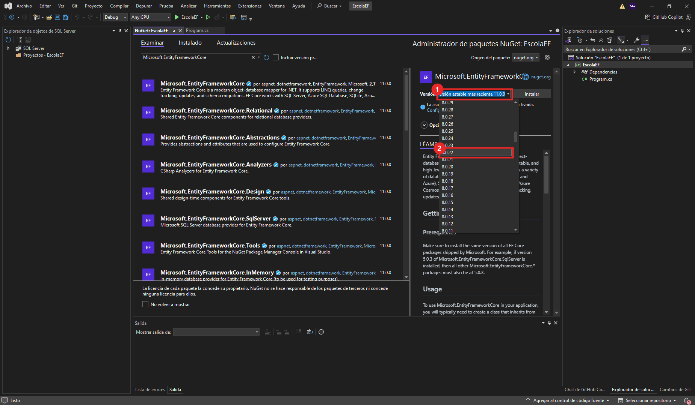

### 2.4 Instal·la

Comprova que posa **8.0.22** (1) i fes clic a **Instalar** (2).

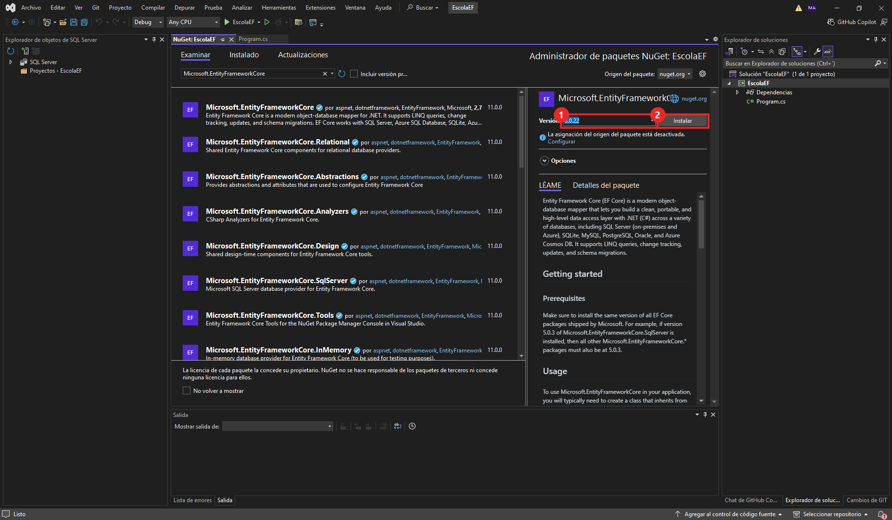

Surt una finestra amb els canvis. Fes clic a **Aplicar**.

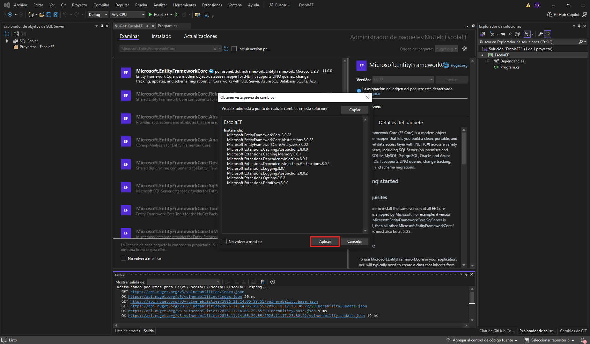

Després surt la llicència (és MIT, de Microsoft). Fes clic a **Aceptar**.

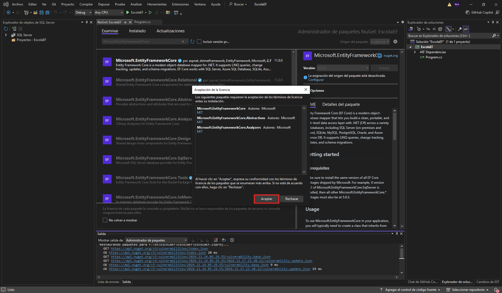

Quan acabi, posarà **Instalado: 8.0.22**.

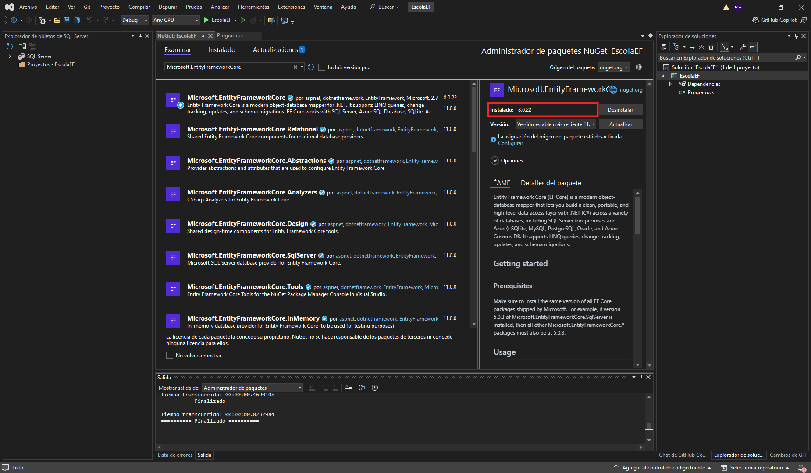

### 2.5 Repeteix-ho amb els altres 4 paquets

Fes el mateix (passos 2.2, 2.3 i 2.4) per a:

- `Microsoft.EntityFrameworkCore.Sqlite`
- `Microsoft.EntityFrameworkCore.SqlServer`
- `Microsoft.EntityFrameworkCore.Tools`
- `Microsoft.EntityFrameworkCore.Proxies`

Recorda: **sempre la versió 8.0.22**.

### 2.6 Comprova-ho

A la pestanya **Instalado** (1) han de sortir els **5 paquets**, tots amb **8.0.22** (2).

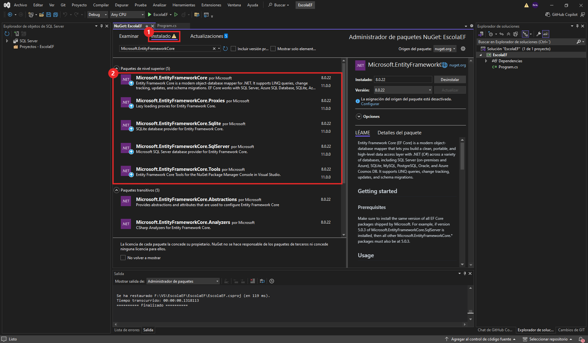

> ⛔ Visual Studio mostrarà una fletxa blava i la pestanya *«Actualizaciones»* (versió 11.0.0). **NO actualitzis.** Si ho fas, el projecte deixarà de compilar.

<details markdown="1">
<summary>🛠️ Alternativa ràpida: Consola del Administrador de paquetes (opcional)</summary>

Menú **Herramientas › Administrador de paquetes NuGet › Consola del Administrador de paquetes**, i escriu:

```
Install-Package Microsoft.EntityFrameworkCore -Version 8.0.22
Install-Package Microsoft.EntityFrameworkCore.Sqlite -Version 8.0.22
Install-Package Microsoft.EntityFrameworkCore.SqlServer -Version 8.0.22
Install-Package Microsoft.EntityFrameworkCore.Tools -Version 8.0.22
Install-Package Microsoft.EntityFrameworkCore.Proxies -Version 8.0.22
```
</details>

---

## 3. Desactivar els «nullable»

Els projectes nous de .NET tenen activats els *nullable reference types*. Això canvia una cosa important respecte a la teoria:

- Amb `nullable` **activat**: un `string` es crea com a `NOT NULL` a la base de dades.
- Amb `nullable` **desactivat**: un `string` és `NULL`, tal com diu el README de teoria.

Per fer-ho igual que a la teoria, el desactivem:

1. Fes **doble clic** sobre el projecte **EscolaEF** a l'Explorador de soluciones. S'obre el fitxer `EscolaEF.csproj`.
2. A la línia de `Nullable`, canvia `enable` per **`disable`** (1).
3. Comprova que hi ha els 5 paquets amb la versió **8.0.22** (2).
4. Desa amb **Ctrl+S**.

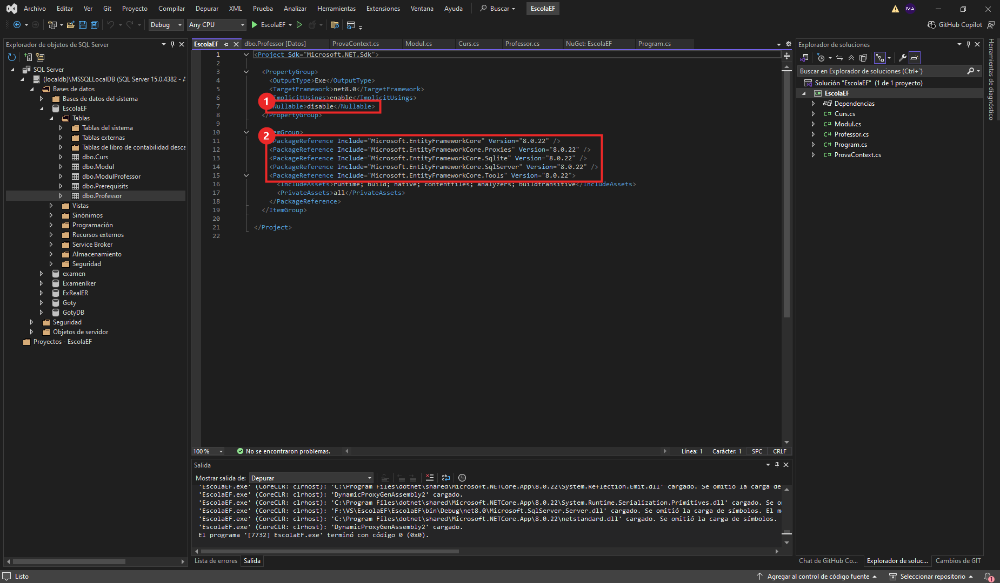

```xml
<Nullable>disable</Nullable>
```

---

## 4. Crear les classes del model

Crearem 3 classes: **Professor**, **Curs** i **Modul**.

### 4.1 Afegir una classe nova

**Clic dret** sobre **EscolaEF** › **Agregar** (1) › **Clase...** (2).

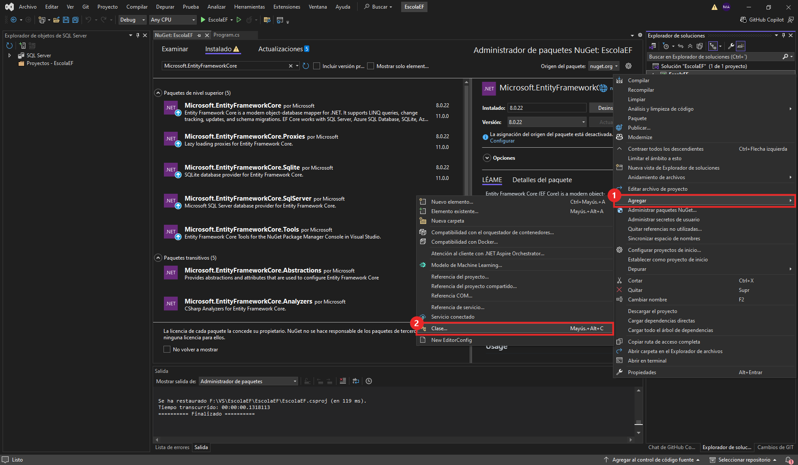

Comprova que està triat **Clase** (1), escriu el nom del fitxer (2), per exemple `Professor.cs`, i fes clic a **Agregar** (3).

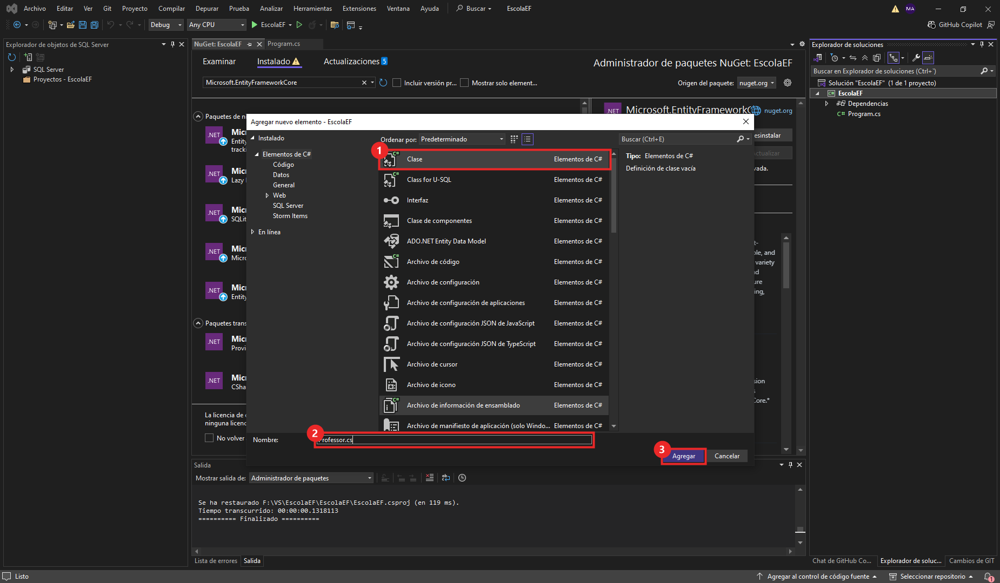

Visual Studio crea el fitxer `Professor.cs` (1).

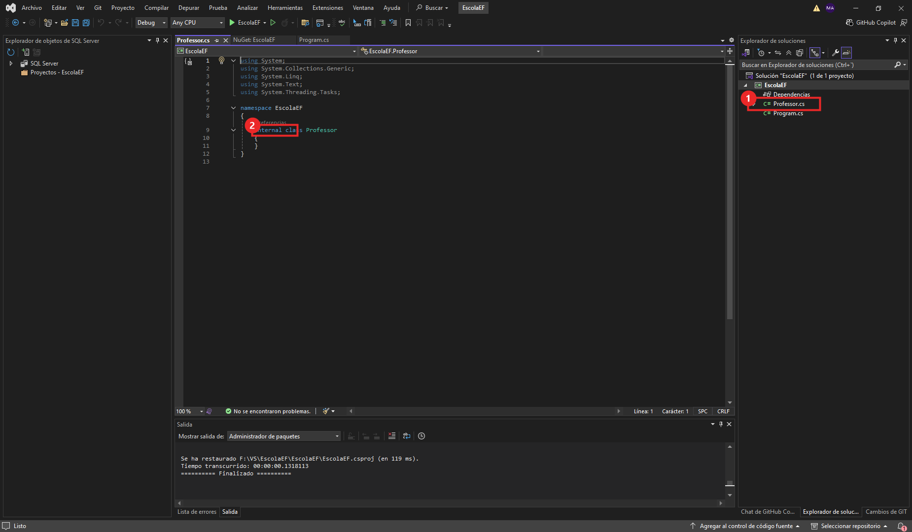

> ⚠️ Visual Studio crea la classe com a **`internal class`** (2). Quan enganxis el codi de sota, quedarà **`public class`**, que és el que volem.

**Fes el mateix per crear `Curs.cs` i `Modul.cs`.**

### 4.2 Professor.cs

Esborra tot el que hi ha al fitxer (**Ctrl+A** i **Supr**) i **copia aquest codi**:

```csharp
using System.ComponentModel.DataAnnotations;

namespace EscolaEF;

public class Professor
{
    public int ProfessorID { get; set; }

    [Required]
    public string nom { get; set; }
    public string cognom { get; set; }

    // 1-1: un professor és tutor d'un curs
    public virtual Curs Curs { get; set; }

    // N-N: un professor fa molts mòduls
    public virtual ICollection<Modul> Moduls { get; set; }

    public Professor()
    {
        Moduls = new HashSet<Modul>();
    }
}
```

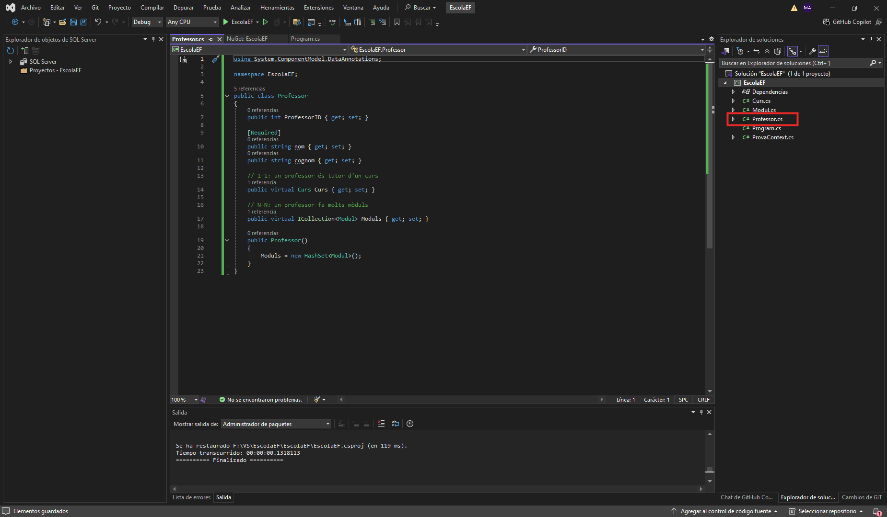

### 4.3 Curs.cs

```csharp
namespace EscolaEF;

public enum CicleFormatiu { DAMVI, DAW, ASIX, SMX }

public class Curs
{
    public int CursID { get; set; }
    public CicleFormatiu Cicle { get; set; }
    public bool Actiu { get; set; }
    public int Any { get; set; }

    // 1-1: el curs té un professor tutor (la FK és aquí)
    public int? ProfessorID { get; set; }
    public virtual Professor Professor { get; set; }

    // 1-N: un curs té molts mòduls
    public virtual ICollection<Modul> Moduls { get; set; }

    public Curs()
    {
        Moduls = new HashSet<Modul>();
    }
}
```

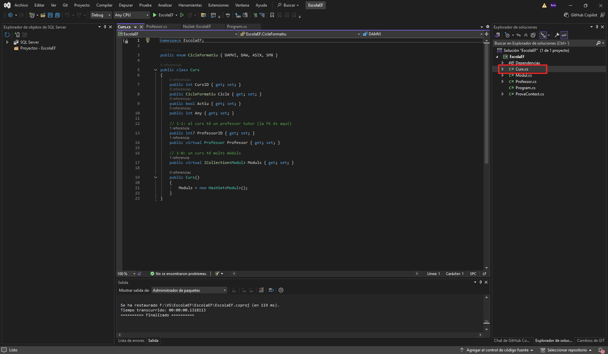

### 4.4 Modul.cs

```csharp
using System.ComponentModel.DataAnnotations;
using System.ComponentModel.DataAnnotations.Schema;

namespace EscolaEF;

[Table("Modul")]
public class Modul
{
    [Key]
    [DatabaseGenerated(DatabaseGeneratedOption.None)]
    public int Codi { get; set; }

    [Required]
    public string nom { get; set; }
    public int horesSetmana { get; set; }

    // 1-N: el mòdul pertany a un curs
    public virtual Curs Curs { get; set; }

    // N-N: un mòdul el fan molts professors
    public virtual ICollection<Professor> Professors { get; set; }

    // N-N recursiva
    public virtual ICollection<Modul> Prerequisits { get; set; }
    public virtual ICollection<Modul> EsPrerequisitDe { get; set; }

    public Modul()
    {
        Professors = new HashSet<Professor>();
        Prerequisits = new HashSet<Modul>();
        EsPrerequisitDe = new HashSet<Modul>();
    }
}
```

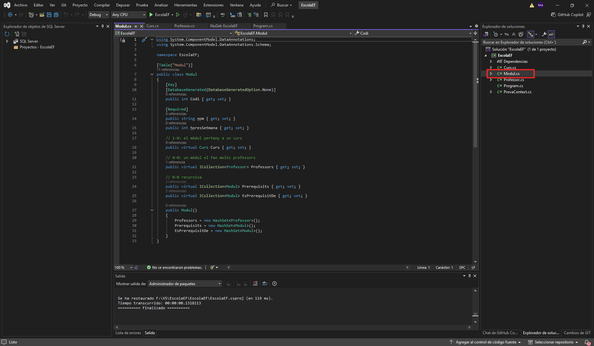

---

## 5. Crear el DbContext

Crea una classe nova que es digui **`ProvaContext.cs`** (com al pas 4.1) i copia aquest codi:

```csharp
using Microsoft.EntityFrameworkCore;

namespace EscolaEF;

public class ProvaContext : DbContext
{
    public DbSet<Professor> Professor { get; set; }
    public DbSet<Modul> Modul { get; set; }
    public DbSet<Curs> Curs { get; set; }

    protected override void OnConfiguring(DbContextOptionsBuilder optionsBuilder)
    {
        if (!optionsBuilder.IsConfigured)
        {
            optionsBuilder
                // OPCIÓ A: SQLite (no cal instal·lar res)
                .UseSqlite(@"Data Source=escola.db")
                // OPCIÓ B: SQL Server LocalDB (comenta la línia de dalt i descomenta aquesta)
                // .UseSqlServer(@"Server=(localdb)\mssqllocaldb;Database=EscolaEF;Trusted_Connection=True;")
                .UseLazyLoadingProxies();
        }
    }

    protected override void OnModelCreating(ModelBuilder modelBuilder)
    {
        // 1-1: Curs <-> Professor (la FK és a Curs)
        modelBuilder.Entity<Curs>()
            .HasOne(c => c.Professor)
            .WithOne(p => p.Curs)
            .HasForeignKey<Curs>(c => c.ProfessorID);

        // N-N recursiva: Modul <-> Prerequisits
        modelBuilder.Entity<Modul>()
            .HasMany(m => m.Prerequisits)
            .WithMany(m => m.EsPrerequisitDe)
            .UsingEntity(j => j.ToTable("Prerequisits"));

        base.OnModelCreating(modelBuilder);
    }
}
```

El requadre (2) marca **la part més important**: la línia que diu **quina base de dades** fem servir.

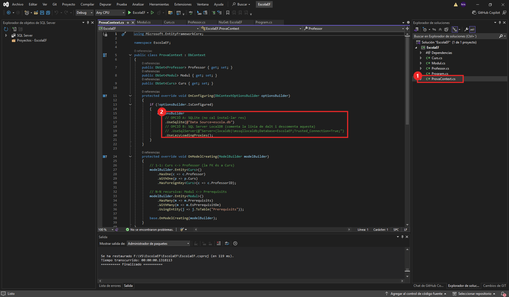

---

## 6. Escriure el Program.cs

Obre **Program.cs**, esborra el que hi ha i copia aquest codi:

```csharp
using EscolaEF;

using (var ctx = new ProvaContext())
{
    ctx.Database.EnsureDeleted();
    ctx.Database.EnsureCreated();

    var marc = new Professor { nom = "Marc", cognom = "Albareda" };
    var m6 = new Modul { Codi = 6, nom = "Accés a Dades", horesSetmana = 4 };
    var m3 = new Modul { Codi = 3, nom = "Programació", horesSetmana = 7 };

    var segonDvi = new Curs { Cicle = CicleFormatiu.DAMVI, Actiu = true, Any = 2026, Professor = marc };
    segonDvi.Moduls.Add(m6);
    segonDvi.Moduls.Add(m3);
    marc.Moduls.Add(m6);
    marc.Moduls.Add(m3);
    m6.Prerequisits.Add(m3);

    ctx.Curs.Add(segonDvi);
    ctx.SaveChanges();

    Professor prof = ctx.Professor.First(p => p.cognom == "Albareda");
    Console.WriteLine($"Professor trobat: {prof.nom}");
    Console.WriteLine($"Cicle on ensenya: {prof.Curs.Cicle}");

    foreach (Modul preq in ctx.Modul.Find(6).Prerequisits)
        Console.WriteLine($"Prerequisit de M6: {preq.nom}");
}
```

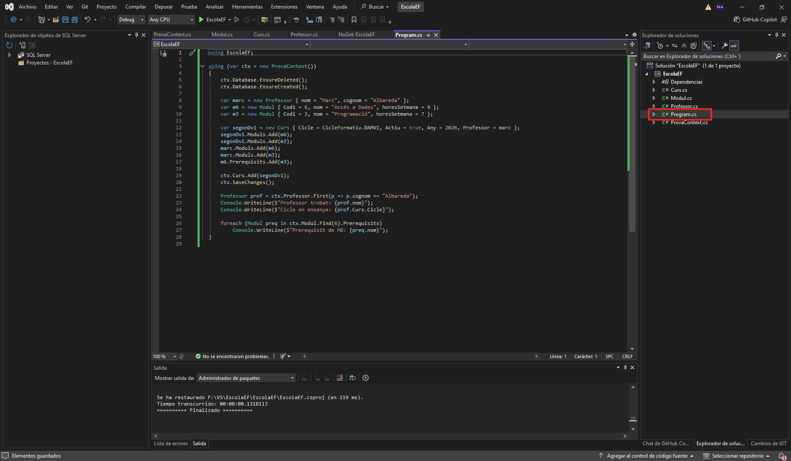

---

## 7. Executar el programa

Fes clic al **triangle verd ▶ EscolaEF** de dalt (o prem **F5**).

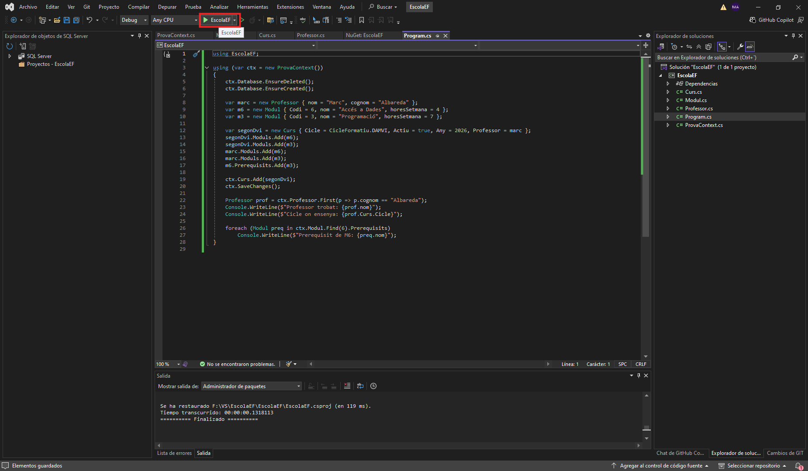

S'obre la **Consola de depuración**. Si tot va bé, hi ha de sortir:

```
Professor trobat: Marc
Cicle on ensenya: DAMVI
Prerequisit de M6: Programació
```

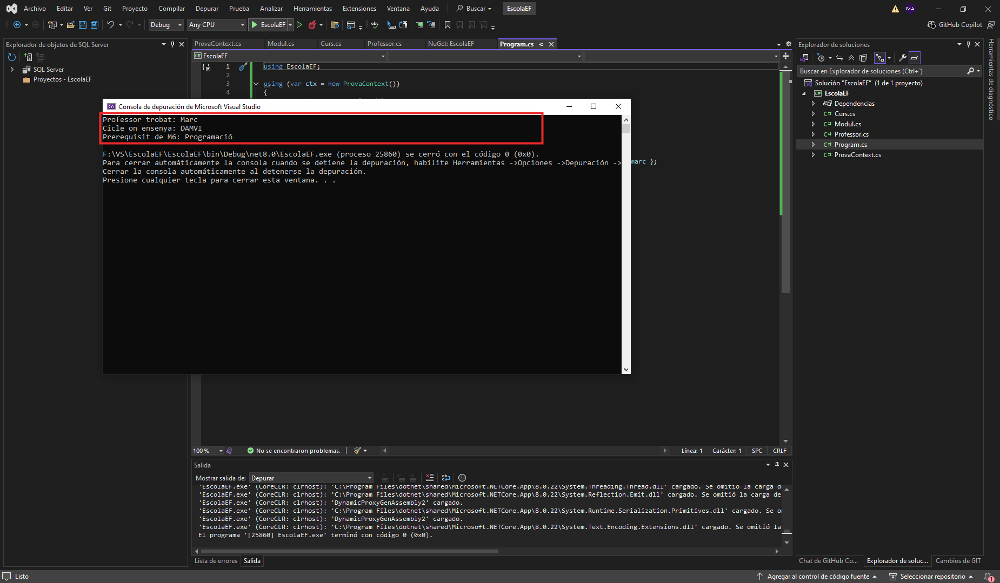

Prem qualsevol tecla per tancar la consola.

> 📁 El fitxer **`escola.db`** es crea a **`D:\EscolaEF\EscolaEF\bin\Debug\net8.0\`**.
>
> Visual Studio **no porta cap visor de SQLite**. Per veure les taules, pots fer servir Rider (mira la guia de Rider) o l'opció B, LocalDB, que sí que es pot veure dins de Visual Studio.

---

## 8. Opció B: SQL Server LocalDB

> ⚠️ Només funciona si l'equip té **SQL Server LocalDB** (càrrega de treball *Almacenamiento y procesamiento de datos*). Per comprovar-ho, escriu `sqllocaldb info` en un terminal: ha de sortir `MSSQLLocalDB`.

### 8.1 Canvia una línia del DbContext

A **ProvaContext.cs**:

- **Comenta** la línia de `UseSqlite` (posa-hi `//` al davant).
- **Descomenta** la línia de `UseSqlServer` (treu-ne el `//`).

```csharp
optionsBuilder
    // OPCIÓ A: SQLite (no cal instal·lar res)
    // .UseSqlite(@"Data Source=escola.db")
    // OPCIÓ B: SQL Server LocalDB
    .UseSqlServer(@"Server=(localdb)\mssqllocaldb;Database=EscolaEF;Trusted_Connection=True;")
    .UseLazyLoadingProxies();
```

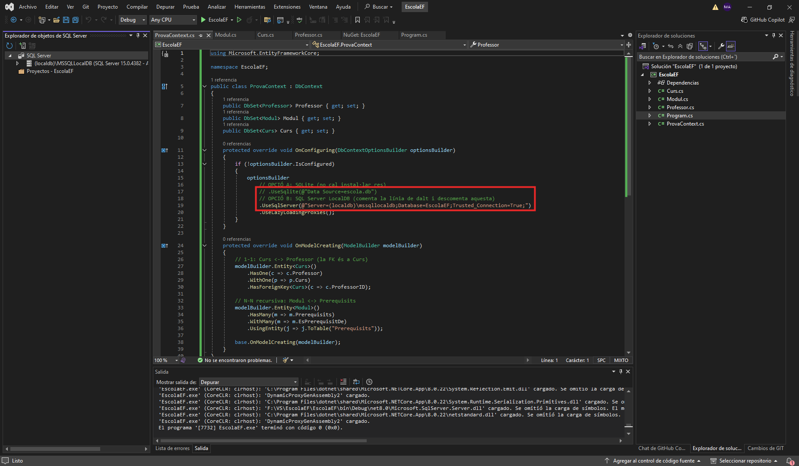

> 💡 Truc de Visual Studio: selecciona les línies i prem **Ctrl+K, Ctrl+C** per comentar-les, o **Ctrl+K, Ctrl+U** per descomentar-les.

### 8.2 Executa

Fes clic al **▶**. Ha de sortir **el mateix resultat** que amb SQLite.

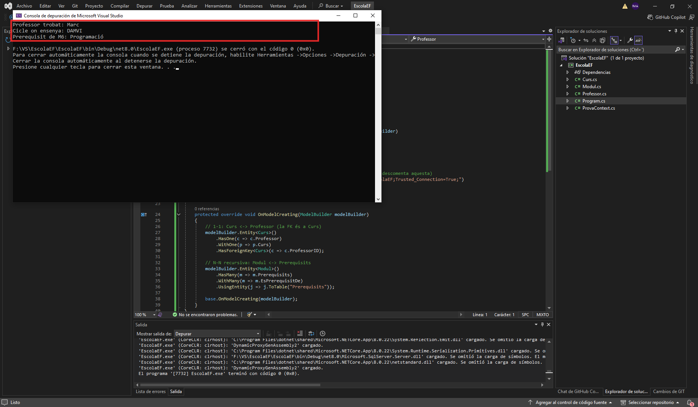

### 8.3 Mira les taules a l'Explorador d'objectes de SQL Server

Si no veus la finestra de l'esquerra, obre-la al menú **Ver › Explorador de objetos de SQL Server**.

Obre **SQL Server › (localdb)\MSSQLLocalDB › Bases de datos › EscolaEF** (1) › **Tablas** (2). Hi ha d'haver les taules que ha creat EF:

- `dbo.Curs`, `dbo.Modul`, `dbo.Professor` → una per cada classe
- `dbo.ModulProfessor` → la taula intermèdia de la relació **N-N** (EF la crea sola)
- `dbo.Prerequisits` → la taula de la relació **recursiva**

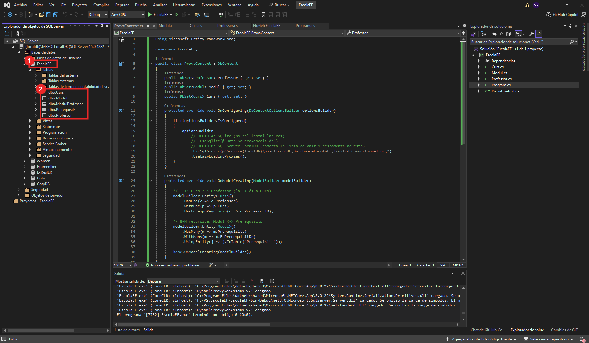

### 8.4 Mira les dades

**Clic dret** sobre **dbo.Professor** (1) › **Ver datos** (2).

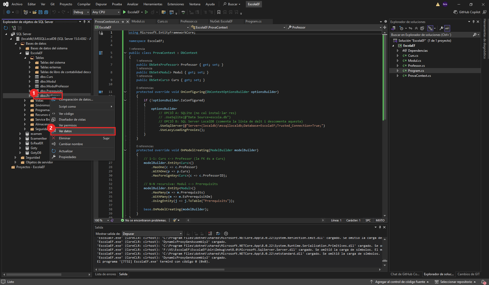

S'obren les dades de la taula:

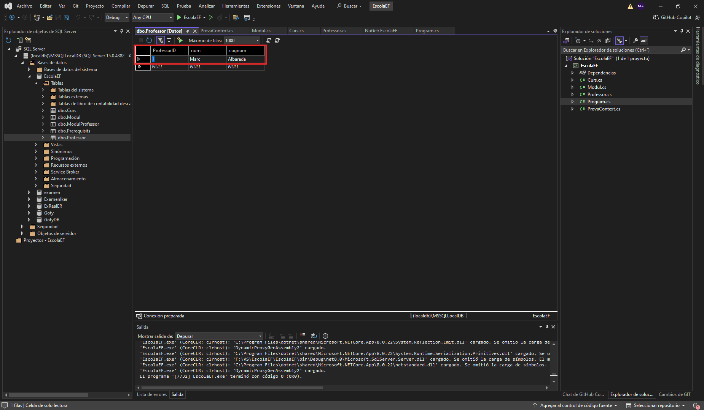

> Si executes el programa una altra vegada, fes clic dret › **Actualizar** per veure les dades noves.

---

## 9. Problemes freqüents

| Problema | Solució |
|---|---|
| Error *«... is not compatible with net8.0»* | Has instal·lat un paquet a la versió **11.0.0** o **10.x**. Torna a NuGet i canvia'l a **8.0.22**. |
| Els paquets no tenen tots la mateixa versió | Posa'ls **tots a 8.0.22**. Barrejar versions dona errors. |
| No surt «.NET 8.0» al desplegable Framework | Falta la càrrega de treball **Desarrollo de escritorio de .NET**. Avisa el professor. |
| La plantilla «Aplicación de consola» no té `Program.cs` sinó `Module1.vb` | Has triat la de **Visual Basic**. Torna a començar i tria la de **C#**. |
| Error *«A network-related or instance-specific error... (localdb)»* | L'equip no té LocalDB. Fes servir **SQLite** (opció A). |
| No surt «Explorador de objetos de SQL Server» al menú Ver | Falta la càrrega de treball **Almacenamiento y procesamiento de datos**. |
| Després de reiniciar, el projecte ha desaparegut | L'havies desat a `C:\`. Desa'l sempre a **`D:\`**. |
| Error *«The entity type ... requires a primary key»* | La clau primària s'ha de dir `ID` o `NomClasseID`, o ha de tenir `[Key]`. |
| `NullReferenceException` en accedir a `prof.Curs` | Revisa que tens `.UseLazyLoadingProxies()` i que la propietat és **`virtual`**. |
