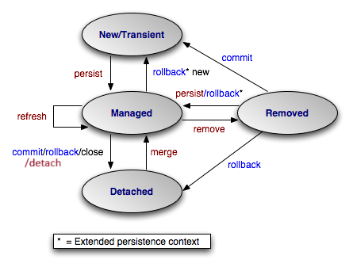

# Hibernate: Configuració, Anotacions i Gestió de Sessions
## Per a estudiants de Cicles Formatius de Grau Superior

### 1. Configuració d'Hibernate
#### 1.1 L'arxiu hibernate.cfg.xml
L'arxiu de configuració d'Hibernate defineix tots els paràmetres necessaris per establir i mantenir la connexió amb la base de dades.

```xml
<?xml version='1.0' encoding='UTF-8'?>
<!DOCTYPE hibernate-configuration PUBLIC
        "-//Hibernate/Hibernate Configuration DTD 3.0//EN"
        "http://www.hibernate.org/dtd/hibernate-configuration-3.0.dtd">
```

#### 1.2 Propietats de Connexió
```xml
<property name="hibernate.connection.driver_class">com.mysql.cj.jdbc.Driver</property>
<property name="hibernate.connection.url">jdbc:mysql://localhost:3306/database</property>
<property name="hibernate.connection.username">root</property>
<property name="hibernate.connection.password">password</property>
```

Propietats principals:
- `connection.driver_class`: El driver JDBC a utilitzar
- `connection.url`: URL de connexió a la base de dades
- `connection.username`: Usuari de la base de dades
- `connection.password`: Contrasenya de l'usuari

#### 1.3 Propietats de Comportament
```xml
<property name="hibernate.hbm2ddl.auto">create</property>
<property name="show_sql">true</property>
<property name="hibernate.current_session_context_class">thread</property>
```

Valors possibles per `hbm2ddl.auto`:
- `create`: Crea les taules al iniciar (esborra les existents)
- `update`: Actualitza l'esquema si cal
- `create-drop`: Crea les taules al iniciar i les esborra al tancar
- `validate`: Només valida que l'esquema coincideix
- `none`: No fa res amb l'esquema

Altres propietats importants:
- `show_sql`: Mostra les consultes SQL generades
- `format_sql`: Formata les consultes SQL per millor llegibilitat
- `dialect`: Específica el dialecte SQL a utilitzar
- `cache.use_second_level_cache`: Activa la cache de segon nivell
- `cache.region.factory_class`: Especifica la implementació de cache
- `current_session_context_class`: Defineix com es gestionen les sessions

### 2. Anotacions d'Hibernate
#### 2.1 Anotacions d'Entitat Bàsiques
```java
@Entity
@Table(name = "nom_taula",
       schema = "nom_schema",
       catalog = "nom_cataleg",
       uniqueConstraints = {
           @UniqueConstraint(columnNames = {"columna1", "columna2"})
       })
```

Paràmetres de `@Table`:
- `name`: Nom de la taula
- `schema`: Esquema de la base de dades
- `catalog`: Catàleg de la base de dades
- `uniqueConstraints`: Restriccions d'unicitat

#### 2.2 Anotacions d'Identificador
```java
@Id
@GeneratedValue(strategy = GenerationType.IDENTITY)
@Column(name = "id")
private Long id;
```

Estratègies de `@GeneratedValue`:
- `IDENTITY`: Autoincrement de la base de dades
- `SEQUENCE`: Utilitza una seqüència de la base de dades
- `TABLE`: Utilitza una taula per generar els IDs
- `AUTO`: Hibernate tria l'estratègia

#### 2.3 Anotacions de Columna
```java
@Column(
    name = "nom_columna",
    length = 100,
    nullable = false,
    unique = true,
    insertable = true,
    updatable = true,
    columnDefinition = "VARCHAR(100) DEFAULT 'valor_defecte'",
    precision = 10,
    scale = 2
)
```

Atributs de `@Column`:
- `name`: Nom de la columna a la base de dades
- `length`: Longitud màxima per strings
- `nullable`: Si permet valors null
- `unique`: Si ha de ser únic
- `insertable`: Si es pot inserir
- `updatable`: Si es pot actualitzar
- `columnDefinition`: Definició SQL directa
- `precision`: Precisió total per decimals
- `scale`: Decimals després del punt

#### 2.4 Anotacions de Tipus Específics
```java
@Temporal(TemporalType.TIMESTAMP)
private Date dataCreacio;

@Enumerated(EnumType.STRING)
private TipusEnum tipus;

@Lob
private byte[] arxiu;

@Transient
private String campCalculat;
```

Tipus de `@Temporal`:
- `DATE`: Només data
- `TIME`: Només hora
- `TIMESTAMP`: Data i hora

Tipus de `@Enumerated`:
- `ORDINAL`: Guarda l'índex de l'enum
- `STRING`: Guarda el nom de l'enum

Altres anotacions:
- `@Lob`: Per a objectes grans (Large Objects)
- `@Transient`: Camp que no es mapeja a la BD
- `@Formula`: Per a camps calculats amb SQL

### 3. Sessions i Transaccions
#### 3.1 SessionFactory
```java
public static synchronized SessionFactory getSessionFactory() {
    if (sessionFactory == null) {
        ServiceRegistry serviceRegistry = new StandardServiceRegistryBuilder()
            .configure("hibernate.cfg.xml")
            .build();
            
        sessionFactory = new MetadataSources(serviceRegistry)
            .buildMetadata()
            .buildSessionFactory();
    }
    return sessionFactory;
}
```

La SessionFactory:
- És thread-safe
- És costosa de crear
- S'ha de reutilitzar
- Representa una base de dades
- Manté la cache de segon nivell

#### 3.2 Sessions
```java
Session session = null;
try {
    session = sessionFactory.openSession();
    // Operacions amb la sessió
} finally {
    if (session != null) {
        session.close();
    }
}
```

Característiques de Session:
- No és thread-safe
- Representa una unitat de treball
- S'ha de tancar després d'usar-la
- Manté la cache de primer nivell
- Gestiona l'estat de les entitats

Estats d'una entitat:
1. `Transient`: Objecte nou, no associat a cap sessió
2. `Persistent`: Objecte associat a una sessió
3. `Detached`: Objecte que estava persistent però la sessió s'ha tancat




#### 3.3 Transaccions
```java
Session session = sessionFactory.openSession();
Transaction tx = null;
try {
    tx = session.beginTransaction();
    
    // Operacions CRUD
    Entitat entitat = new Entitat();
    session.persist(entitat);
    
    tx.commit();
} catch (Exception e) {
    if (tx != null) tx.rollback();
    throw e;
} finally {
    session.close();
}
```

Característiques de les transaccions:
- Garanteixen ACID (Atomicitat, Consistència, Aïllament, Durabilitat)
- S'han d'usar per a totes les operacions d'escriptura
- Cal fer commit o rollback explícit
- És recomanable usar try-catch-finally

#### 3.4 Operacions amb Sessions
```java
// Persistència
session.persist(entitat);     // Guarda una nova entitat
session.merge(entitat);       // Actualitza una entitat
session.remove(entitat);      // Elimina una entitat
session.saveOrUpdate(entitat);// Guarda o actualitza

// Consultes
Entitat e = session.get(Entitat.class, id);     // Càrrega immediata
Entitat e = session.load(Entitat.class, id);    // Càrrega lazy

// Gestió de la cache
session.flush();             // Sincronitza amb la BD
session.clear();             // Neteja la cache
session.evict(entitat);      // Elimina de la cache
```

Consideracions importants:
1. `get()` vs `load()`:
   - `get()` retorna null si no troba l'entitat
   - `load()` retorna un proxy i llança excepció si no troba
   
2. `merge()` vs `update()`:
   - `merge()` crea una còpia de l'entitat
   - `update()` fa l'entitat persistent directament

3. Cache de primer nivell:
   - Automàtica dins d'una sessió
   - Es pot netejar amb `clear()` o `evict()`
   - Es sincronitza amb `flush()`

### 4. Bones Pràctiques
1. Gestió de Sessions:
   - Usar try-with-resources o try-catch-finally
   - Tancar sempre les sessions
   - No mantenir sessions obertes molt temps

2. Transaccions:
   - Sempre usar transaccions per escriptura
   - Mantenir les transaccions el més curtes possible
   - Gestionar correctament els rollbacks

3. Configuració:
   - Usar properties externes per configuració
   - Configurar adequadament els pools de connexions
   - Monitoritzar el rendiment SQL

4. Excepcions:
   - Capturar i gestionar `HibernateException`
   - Implementar logging adequat
   - Fer rollback en cas d'error